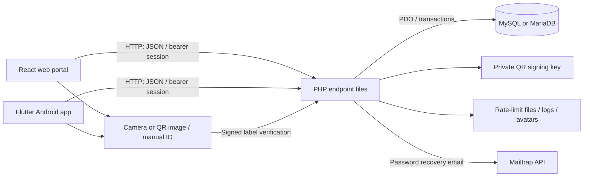

# SmartFlow architecture

Status: current implementation context, inspected 2026-10-15. This describes the checked-out source and the local review setup; it does not certify a production deployment. See [PRD](PRD.md), [Database](DATABASE.md), and [Security](SECURITY.md) for the product boundary, schema, and trust boundaries.

The **16 October bounded stabilization** keeps the existing components and API contracts. A shared request read predicate governs both Requests and linked-ticket evidence; broader unrelated-folder detail/history policy remains unresolved. Privileged writers use locked current caller/session validation after resource waits. Summary queries share a repeatable-read transaction; system backup fingerprints and continuity-folder evidence come from an isolated import of the actual dump. Native login attempts own their queued preference writes: a candidate is published only after persistence succeeds, and a cancelled candidate restores the committed pair. Protected pages reset by token/user/office/role identity; observers remove the old identity's root and shell popup routes. Confirmations and submissions retain the reviewed API/session. A pending logout blocks new dispatches, while mounted callbacks for the unchanged login can settle an already-dispatched result and clear busy state. Web camera sessions consume one decode and require explicit camera restart for another label. Launch helpers parse in both installed Windows shells; legacy SQL restore preserves input bytes. See the [acceptance matrix](testing/STABILIZATION-MATRIX-2026-10-16.md) and [report](../.runtime/stabilization-2026-10-16/report.md); device/hosting acceptance remains separate.

The later [polished-flow pass](../.runtime/polished-flow-report.md) adds the protected local PHP launcher and the scoped folder/request/client contracts below. Current evidence is 517 isolated API, 74 web, 152 full Flutter and 42 synthetic router checks, clean final analysis/builds, six-file XAMPP deployment with 90-file parity, and data-preserving APK installation. Protected native visual review still needs sign-in. The [preceding flow review](../.runtime/current-flow-review-2026-10-15.md) remains historical pre-fix evidence.

## System boundary

The later [developer/session/mobile pass](../.runtime/three-gap-remediation-report.md) adds HTTP-inaccessible legacy maintenance with explicit CLI opt-in, generic recovery responses, per-login web API clients and cross-tab invalidation, and native admin DV-action parity. Normal launch is read-only with respect to operational data; explicit code-only deployment preserves runtime files. Its final evidence is 525 isolated API / 83 web / 167 Flutter checks plus separate hosting/security suites.

SmartFlow tracks physical inter-office folders and the requests associated with them. A request decision does not record physical custody. Users register a folder already at their office, then record each actual IN/OUT handoff. Disbursement request completion records that Treasury released payment; SmartFlow does not execute a financial approval, payment, or payroll calculation.

Pilot office codes are ENG, HR, BUD, ACC, TRE, and MAY. Roles are `staff`, `head`, and `admin`. Both clients use the same PHP endpoints and database; their navigation and screen composition are separate implementations. Shared behavior comes from the API contract, not a shared UI package.

An `auditor` role also appears in the development account helper and isolated denial-test fixtures. It is not offered by normal signup or established as a fourth client workspace. Do not infer a supported auditor user journey from those fixtures. See [development helper](../backend/backend/api/dev-create-user.php) and [isolated test fixtures](../scripts/test-request-linking.php).

## Components



| Layer | Implemented structure | Manifest or entry point |
|---|---|---|
| Web | React 19, React Router 7, Vite 8; custom CSS; `html5-qrcode` camera/image decoding and `qrcode.react` display | [package.json](../web/package.json), [main.jsx](../web/src/main.jsx), [App.jsx](../web/src/App.jsx) |
| Mobile | Flutter/Dart, Provider state, GoRouter navigation, `http`, `mobile_scanner`, `image_picker`, `shared_preferences`, `qr_flutter`, Google Fonts | [pubspec.yaml](../mobile/flutter/pubspec.yaml), [main.dart](../mobile/flutter/lib/main.dart), [router.dart](../mobile/flutter/lib/router.dart) |
| API | Independent `.php` endpoint files sharing configuration, helpers, JSON responses, and PDO | [config.php](../backend/backend/api/config.php), [API directory](../backend/backend/api/) |
| Database | Relational folder, movement, request, user, office, session, threshold, checklist, and audit data; InnoDB transaction-dependent flows | [Database context](DATABASE.md), [schema-bootstrap.php](../backend/backend/api/schema-bootstrap.php) |
| Files | Server-side QR key, request-rate windows, dated diagnostic logs, profile images; client-side session, drafts and pending movement/creation recovery | [QR helper](../backend/backend/api/qr-token-helper.php), [rate-limit.php](../backend/backend/api/rate-limit.php), [movement recovery](../mobile/flutter/lib/services/movement_recovery.dart), [creation recovery](../mobile/flutter/lib/services/creation_recovery.dart) |

Manifest version ranges describe dependencies, not a guarantee of the installed version on another machine. Lockfiles should be retained for reproducible installs. The Flutter manifest requires Dart `>=3.12.0 <4.0.0` and Flutter `>=3.44.0`. PHP code uses `array_is_list`, so PHP **8.1 or later** is required by the current source; the older production guide's PHP 8.0 minimum is stale. Required extensions include PDO MySQL, JSON, mbstring, fileinfo for avatar uploads, and cURL for recovery email. Database compatibility must be exercised against the actual target server; the older guide's version floor is not a test result.

## Repository map

| Path | Responsibility |
|---|---|
| `web/src/pages/` | Staff, head, admin, authentication, document, request, reporting, and profile pages |
| `web/src/components/` | Application shell and reusable document, journey, QR, help, and UI components |
| `web/src/api.js` | Endpoint wrappers, authentication transport, response/error decoding |
| `web/src/connection.js`, `live-refresh.js` | Connection status, 30-second request timeout, visible-page refresh |
| `web/src/index.css`, `sf-life.css`, `page-layout.css` | Existing shared and page layout styles; later rules may override earlier rules |
| `mobile/flutter/lib/screens/` | Auth screens, role shells, shared documents/requests/register/profile workflows |
| `mobile/flutter/lib/services/` | API client/wrappers, connectivity, movement and creation recovery |
| `mobile/flutter/lib/widgets/`, `theme/`, `utils/` | Reusable UI, visual tokens/icons, formatting and queue helpers |
| `backend/backend/api/` | API entry points and business-rule helpers; some schema creation/upgrades happen at runtime |
| `scripts/` | Local startup, APK builds, XAMPP sync, backups/restore, smoke and integration tooling |
| `web/test/`, `mobile/flutter/test/` | Client behavior and layout checks; web fixture runs isolated sample data |
| `docs/` | Product context, historical thesis/client/defense material and these maintained context documents |
| `.runtime/` | Local review artifacts and reports; not application source or a deployment contract |

Older README paths such as `Capstone -Neil`, optional mock directories, and historic clients must not be assumed present. Inspect this checkout before following those commands.

## Routes and identity

The web router has public login/signup/recovery pages and protected routes for office work (`/home`, `/documents`, `/scan`, `/register`, `/requests`, `/history`, `/alerts`, `/profile`), head pages, and admin pages. Role checks guide entry to the appropriate home and admin views. Flutter uses separate `/staff/...`, `/head/...`, and `/admin/...` route families with shared screen implementations where useful.

The web auth provider keeps the token and user payload in browser local storage. Protected views use the provider's session-bound API facade; storage/focus changes clear old views/dialogs and validate the replacement account. Transport checks reject old-login writes before dispatch and stale results after response-body consumption. Flutter keeps its token/user in shared preferences. Both validate sessions through `auth-session.php`, periodically and on relevant foreground/resume events, and clear identity after a matching invalid/expired or deactivated-session response. Flutter development builds normally clear a saved session on cold start unless `FORCE_LOGIN_ON_START=false` is supplied. See [auth.jsx](../web/src/auth.jsx), [auth_provider.dart](../mobile/flutter/lib/providers/auth_provider.dart), and [API configuration](../mobile/flutter/lib/config/api_config.dart).

Explicit logout now revokes the presented server token before clearing the matching client login. Failure preserves the protected session and visible retry/error. Ordinary password change revokes all user sessions and requires sign-in again; deactivation revokes sessions without reviving them on reactivation. New signup status requires a private key in a POST body. Pre-key legacy requests require fresh credentials; approved requests bind to the created user's immutable ID, with request code/current credentials supporting rename. Historical approved requests without key or binding require administrator assistance rather than username-based identity guesses. Follow-up verification passed 278 isolated API checks, 32 web tests and 103 Flutter tests, with analysis/builds passing; protected emulator review remains pending user sign-in. Evidence is separate from the earlier priority batch in the [follow-up report](../.runtime/system-gap-followup-report.md).

Client route/UI checks are not the authorization boundary. The server checks active sessions, roles, office ownership and state. Registration, IN/OUT and filing are now staff-only at the API; head/admin document/scan views inspect custody. Their request/checklist/deadline authority remains separate. Flutter exposes own-office checklist management at `/head/checklists` and `/admin/checklists`, without physical-page counts or registration. [Security](SECURITY.md) records enforcement details and remaining visibility questions.

## API contract

Endpoint names are explicit, such as `auth-login.php`, `office-documents.php`, and `movements-create.php`; there is no separate Node API. JSON requests use GET query parameters or POST bodies. Uploads use multipart form data. Typical response shape:

```json
{ "success": true, "message": "Action recorded", "document": { "id": "DOC-2026-000001" } }
```

```json
{ "success": false, "message": "Refresh and review the current location", "scan_error": "document_changed" }
```

The root fields depend on the endpoint: `user`, `documents`, `request`, `requests`, summaries, pagination, or movement outcome may be returned. Both clients reject an unsuccessful HTTP status or `success: false`. Error responses can carry `scan_error`, `qr_error`, and `retry_after`. Authentication errors are 401; denied scope is generally 403; invalid input is generally 400; competing or invalid state is generally 409. These examples are schematic, not an exhaustive schema.

Authenticated clients now send a bearer token and compatibility authentication headers only. The server no longer accepts session tokens from URL queries or request bodies; deployment must forward a supported header. Report exports and printable QR-label content are fetched with those headers as well. Web opens fetched labels as temporary Blob content, keeping credentials out of navigation URLs. Report export endpoints additionally return CSV or printable HTML; QR/profile endpoints may return HTML or image content rather than the JSON envelope. See [web API](../web/src/api.js), [Flutter client](../mobile/flutter/lib/services/api_client.dart), and [report renderer](../backend/backend/api/report-export-helper.php). Existing token-bearing bookmarks stop authenticating; historical access logs are not rewritten by the transport change.

## Core data flows

### Usability contract additions and local runtime repair

The later screenshot-authorized clarity pass uses `status=active` (pending/approved) and `status=past` (fulfilled/rejected/cancelled) on `document-requests-list.php`. Existing single-status values and the default unfiltered API behavior remain compatible. Whole-scope counts add `active` and `past`; filtering still precedes pagination and exact office/requester-scoped IDs ignore the selected list filter. Web starts with active work and serializes an explicit `filter=all` when requested, preserving request return context.

`admin-thresholds-update.php` accepts both processing and unconfirmed-receipt limits from current clients. An older caller may omit the latter only for an existing rule; the endpoint locks and preserves that rule's saved receipt limit. New rules require both values. No default zero or guessed replacement is stored.

The running local Vite proxy was still using an older XAMPP code copy: its office-history endpoint returned 404 HTML, causing Invalid server response. A reviewed, backed-up twelve-file PHP code update repaired the missing History dependencies and aligned the request listing/update/creation/recovery dependencies used by the current UI. The configured proxy/API base, runtime config, environment and QR-secret files were preserved; no mirror/restore/reseed or operational-record mutation was used. The repaired unauthenticated History route returns 401 JSON. This is local deployment evidence for the named files, not proof that every XAMPP file or production deployment matches the workspace. See the [usability report](../.runtime/usability-clarity-report.md).

The subsequent [remaining-gap audit](../.runtime/post-clarity-audit.md) found deployed authentication/signup/custody, municipal scope/correction drift and source History/Scan/query/error/report issues. The later [five-item remediation](../.runtime/gap-remediation-report.md) corrected those source issues and deployed a reviewed 19-file dependency package; at that check all 90 top-level PHP files matched XAMPP. Runtime environment/settings/QR material and operational records were preserved. The separate loopback private-file exposure was outside that batch and is addressed by the later protected development launcher below. Broader route/visibility policy was not changed.

The earlier [follow-up remediation](../.runtime/followup-remediation-report.md) deployed six scoped PHP changes for separate request evidence, filing guards and locked deadline editing. At that check all 90 top-level PHP files matched XAMPP with no target-only PHP extras; runtime settings, environment/private material and operational records were preserved. That historical alignment does not establish deployment of later source changes.

### Registration and QR label

1. An authenticated staff user opens registration for the office that physically holds the folder. The client persists a scoped creation operation ID and payload before POST. The API validates role, office, allowed type, metadata, due date and optional contents inventory.
2. A transaction creates the document, initial IN movement, and signed QR issuance data. If registration comes from an accepted request, the request is then validated and locked for linking before commit.
3. Document creation, initial IN movement, signed QR data, optional request link and supplied operation outcome commit together. Failure rolls back that transaction. Replaying the same actor/kind/ID/payload returns its saved result; a mismatched operation is rejected.
4. The returned tracking ID and QR identify the folder. Downloading or opening a label does not move it.

Source: [documents-create.php](../backend/backend/api/documents-create.php), [request linking helper](../backend/backend/api/document-requests-helper.php), [QR helper](../backend/backend/api/qr-token-helper.php).

### Lookup and physical handoff

1. Camera/image decoding produces a signed `SF1` label, or a user enters the tracking ID manually. A signed label is verified by the API before its document is opened.
2. Document endpoints return the current movement, journey, contents, deadline, suggested destination, and allowed next actions.
3. Mark OUT requires the folder currently IN at the caller's office and a different, valid receiving office. Mark IN follows the selected OUT destination. A return needs a reason and a destination that previously held the folder.
4. `movements-create.php` locks the document and checks the current state again. Every Scan/system IN/OUT requires and compares the displayed `expected_movement_id`, preventing an intervening movement cycle from passing simply because office/status match again. Scan explicitly permits guard0 only for a still-absent legacy movement; system requires a positive ID and confirmed physical receipt for IN. The clients freeze the reviewed ID through dialogs; no submit-time lookup silently replaces it.
5. The movement and supplied recovery request outcome commit together. Rejections have structured reasons and attempt audit logging. Filing ends further movement for eligible folders.

The client interaction now collects physical confirmation once in the receipt dialog. Web [recordConfirmedReceipt](../web/src/custody-actions.js) invokes the existing receipt UI and sends no movement when it is cancelled; native Documents/Scan call the existing [receipt dialog](../mobile/flutter/lib/widgets/folder_contents.dart) and use its confirmed result. Inventory counts, discrepancy reasons and expected-movement guards remain in the payload. Web [FolderHandoff](../web/src/components/FolderHandoff.jsx) centralizes Scan/Documents OUT controls; native uses its existing OUT destination dialog with aligned suggestion data and button wording. The API contract and routing/role rules are unchanged.

Source: [movements-create.php](../backend/backend/api/movements-create.php), [movement rules](../backend/backend/api/movements-helper.php), [documents-file.php](../backend/backend/api/documents-file.php).

Explicit filing requires the positive displayed `expected_movement_id` and compares it after taking the same document lock used by movements. Native filing captures that ID before confirmation. `documents-update-due.php` now also takes this lock before checking latest-acting-office head scope and writing. It requires `expected_movement_id >= 0` and raw nullable `expected_due_at`; direct and queue detail responses expose `manual_due_at` for that saved value separately from calculated `due_at`. Admin remains global and the sending head remains eligible while its OUT is unreceived. No client currently exposes a deadline setter.

Web Documents and Scan now share [FolderFiling](../web/src/components/FolderFiling.jsx) and `recordConfirmedFiling`, which retain the reviewed folder/movement through confirmation. Scan separately records a confirmed save before attempting its follow-up detail read; a failed read marks custody unverified, disables physical actions and offers Retry without repeating the write. See [custody-actions.js](../web/src/custody-actions.js).

Suggested DV route is ENG → BUD → ACC → TRE → MAY → TRE, with an optional return to ACC after release. Approved Budget reaches ACC after BUD. Suggestions and route-completion rules do not imply that every intermediate destination is a universal hard routing constraint. See [routing-helper.php](../backend/backend/api/routing-helper.php).

The shared routing classifiers give explicit named Others priority over financial words. Suggestions, fixed-route filing, completion SQL, DV return controls and financial audit warnings use that boundary; tested legacy leading spaces/tabs/newlines behave consistently. Financial legacy rules remain, with no stored-record rewrite.

### Recording correction of an unreceived destination

`movements-correct-destination.php` is separate from handoff creation. Sending-office staff can correct only the latest unreceived OUT with an explicit reason/confirmation and the displayed movement, destination and last correction ID. The endpoint locks the document, appends `movement_destination_corrections`, updates the effective OUT destination and stores an owner-bound movement-request outcome together. Original event ID/time/counts stay unchanged; corrected destination governs incoming trays and receipt validation. Return/terminal DV constraints remain enforced, and a received/filed/stale record is rejected.

Both clients use this explicit action in folder details and show correction evidence alongside journeys/history. Recovery reuses `movement-requests.php`, with a discriminator preventing ordinary-movement/correction replay confusion. A lost response triggers outcome lookup, not an automatic second write. See [correction endpoint](../backend/backend/api/movements-correct-destination.php), [helper/table](../backend/backend/api/movement-corrections-helper.php), [web control](../web/src/components/DestinationCorrection.jsx), and [native control](../mobile/flutter/lib/widgets/destination_correction.dart). This path does not undo an actual receipt or erase history.

### Requests

Requests are tickets separate from custody. Budget access requests go to BUD; disbursement access requests go to ACC. Every new pull stores category `general` and uses the selected existing other office, normalizing stale allowed access categories from older callers. By-type Others keeps its category and selected handler. Existing tickets and recorded creation responses retain their original category. A pending ticket can be accepted or declined, an accepted ticket can be linked to a folder, and eligible tickets can be cancelled or fulfilled. DV completion requires prior Accounting acceptance and Treasury release handling, with an admin override in the API. Linking alone does not fulfill a ticket or record a handoff. An accepted but incomplete ticket can still be overdue.

All decisions and linking lock the request before state validation/write. Current clients submit displayed `expected_status` and `expected_revision`; changed decisions or links produce 409 `request_conflict`. Older callers may omit these guards. Closing and explicit linking share folder category and handler evidence validation; a Treasury closer cannot introduce an Accounting link. Completion retains reviewer identity and records `fulfilled_by`/`fulfilled_office_id` separately. Treasury's inbox retains DV work fulfilled with recorded Treasury office evidence; old unknown closers are not guessed.

The request helper now adds nullable review-office and fulfillment/cancellation evidence fields before transactions. Review notes/actor/time survive later completion or cancellation, whose full notes/actor/office/time are stored separately and included in the revision. Both clients display stages separately; legacy mixed notes retain available generic recorded metadata with an ambiguity disclaimer. These note fields remain in scoped request responses rather than being added to broad folder lookup. See [Database](DATABASE.md) and the [follow-up remediation report](../.runtime/followup-remediation-report.md).

`document-requests-list.php` returns server-filtered pages (`page`, `page_size`, status, overdue, `q`) and whole-view counts. Scoped exact `id` lookup ignores the current page/filter so permitted old links remain accessible. `office-movements-list.php` supplies complete office/day history with date, IN/OUT filtering, page metadata and whole-day counts; dashboard recent movements remain a preview. Both clients use these contracts instead of filtering a capped preview as though it were complete.

Linked folders open directly in Documents on both platforms; History remains a secondary action. Office detail first uses the existing scoped queue endpoint. A 404 for an out-of-tray linked folder may use the already authenticated direct tracking/journey endpoints and render the result read-only, with no filing/correction/handoff actions. Permission errors such as 403 are propagated rather than retried through broader lookup. This reduces navigation without changing server visibility or custody permissions.

Web [request-navigation.js](../web/src/request-navigation.js) validates committed `tab`, `filter`, `q`, `page` and `id` parameters; Requests reads this URL state directly instead of resetting local filters after a folder visit. The Documents link carries a React Router `requestReturnTo` plus request code. Documents accepts only a local `/requests` return path and exposes Back to request. Native pushes Documents with `fromRequest`, preserving the underlying Requests state; popping back reloads the list and exact permitted ticket before reopening details. Neither client relaxes request revisions or uses the return context to authorize data access.

New and recovered creations reveal the exact permitted request even when the previous list would filter it out, with a return to that previous view. Native query identity includes account, tab, status/overdue/search and page: rows/counts belong to their successful loaded query, changed-query failures cannot reuse old results, and stale/unverified reads block decisions. Final native identity-guard verification is recorded in the [current report](../.runtime/polished-flow-report.md).

Source: [request helper](../backend/backend/api/document-requests-helper.php), [create](../backend/backend/api/document-requests-create.php), [update](../backend/backend/api/document-requests-update.php), [request listing](../backend/backend/api/document-requests-list.php), [office movement listing](../backend/backend/api/office-movements-list.php). Payroll folder requests are explicitly excluded in this phase.

### Monitoring, freshness, and recovery

Office queues derive location from the latest movement rather than a client-maintained counter. Deadline/threshold helpers classify current office waits and unconfirmed transfers. Head/admin endpoints aggregate those records for queues, alerts, analytics, and custody support reports.

Head/admin dashboards in both clients now show initial load failures as unavailable with retry. On refresh failure they retain and label earlier data as potentially stale; an unsuccessful request does not update the last-success timestamp or prove zero counts. This is a scoped dashboard reliability improvement, not evidence that every aggregate endpoint/error path has been audited.

Web QR monitoring and head Analytics now scope retained snapshots to account and outcome/month and distinguish unavailable/stale reads from verified empty results. Selected web request detail has a separate account/ticket-scoped read state: decisions, linking and register-from-request require a successful exact-ticket read; list refresh cannot clear its error. Native Retry exceptions resets the exception-read error on success. These [follow-up repairs](../.runtime/followup-remediation-report.md) preserve the existing API bases, visibility and custody authority.

The later native Requests/Documents contract binds list rows, counts and update time to the loaded account/query, including Documents tray and committed search. Changed-query failures clear unrelated results; same-query failures label retained data stale and disable write actions. Exact request detail verification remains independent of a successful list refresh.

Visible web pages and Flutter screens generally poll every 15 seconds and refresh on foreground/reconnect events. This is polling, not WebSockets, push notifications, or guaranteed instantaneous synchronization. The 30-second API timeout does not imply a failed write: clients tell users to check the outcome before resubmitting. Flutter persists a scoped pending movement and asks `movement-requests.php` whether it was recorded/cancelled. Request IDs bind to the actor/document/payload, preventing an outcome from being reused for another action. This is recovery for supported movements, not a general offline write queue.

Folder and request creation now also persist account/office/kind-scoped recovery before POST. On an uncertain response, both clients read `creation-requests.php` for that operation; they do not automatically resend. A user may check the outcome or explicitly retry the saved payload/ID. Changed forms are blocked while an unresolved submission exists. Client check/submission guards and matching-ID cleanup prevent an old response from deleting a newer pending operation. The API stores outcome and created record together in `creation_requests`; operation IDs remain optional for older external clients.

Source: [web refresh](../web/src/live-refresh.js), [Flutter refresh](../mobile/flutter/lib/utils/live_refresh.dart), [movement recovery](../mobile/flutter/lib/services/movement_recovery.dart), [movement request helper](../backend/backend/api/movement-requests-helper.php), [office queue](../backend/backend/api/office-queue-helper.php).

## Local runtime and addresses

| Target | Address/configuration |
|---|---|
| Web dev UI | `http://localhost:5173`; run Vite inside `web/` |
| Default web API | `/smartflow-api`, proxied by Vite to local Apache at `/Smartflow/backend/backend/api`; override with `VITE_API_BASE` |
| Protected local development API | `http://127.0.0.1:8000/backend/backend/api`; launch with `scripts/start-api-dev.ps1` |
| Android emulator for that review server | `API_BASE=http://10.0.2.2:8000/backend/backend/api` supplied with `--dart-define` |
| Default Android emulator API | `http://10.0.2.2/Smartflow/backend/backend/api` (Apache port 80 assumption) |
| Default other Flutter targets | Loopback API URL from `api_config.dart`; a physical phone instead needs the server's reachable LAN address |
| Flutter production mode | `ENV=production` selects the configured HTTPS production hostname; in current code this takes precedence over `API_BASE` |

From the workspace root, start the existing API without setup, sync, reseeding or data reset:

```powershell
.\scripts\start-api-dev.ps1
```

Add `-Foreground` to keep it attached to the terminal; an occupied port is rejected without stopping another process. The launcher binds to `127.0.0.1` and uses [dev-router.php](../scripts/dev-router.php) to expose only top-level API PHP scripts and two public label assets. Private keys, environment/log/cache/backup/SQL files and repository paths return 404 for GET/HEAD. Synthetic router checks passed 42; local HEAD checks verified private 404, normal protected API 401 and label JavaScript 200, while XAMPP's private-key 403 remains. No key contents, key rotation or settings changes were involved.

Android's `10.0.2.2` reaches the host; `localhost` on a physical phone means that phone. The protected launcher is local-only. Vite dev proxy behavior is not carried into a static production build: production requires a configured API URL or equivalent reverse proxy. [vite.config.js](../web/vite.config.js), [web API](../web/src/api.js), [Flutter API configuration](../mobile/flutter/lib/config/api_config.dart).

## Platform and deployment limits

- Web and Android emulator were exercised in this workspace's earlier implementation reviews. These context documents were created by source inspection; no new production deployment or platform certification was performed.
- An iOS native shell exists with camera/photo permissions and CocoaPods setup, but an iOS build/device run has not been verified here. It requires macOS/Xcode/signing. Broad ATS exceptions are still present. [iOS notes](../mobile/flutter/ios/README.md), [Info.plist](../mobile/flutter/ios/Runner/Info.plist).
- Flutter desktop/web branches appear in API configuration, but that does not establish a working packaged desktop or Flutter-web target. The React portal is the verified web client.
- Runtime bootstrap and endpoint helpers may create or alter schema, even on some GET requests. Read-only HTTP must not be equated with zero database changes. Production migration/privilege planning remains a separate decision.
- Existing [production guide](product/PRODUCTION-DEPLOYMENT.md) is useful historical guidance but contains stale assumptions. The configured production hostname is an intended target, not evidence of live hosting. Use current source and [Security](SECURITY.md) to reconcile it before deployment.

## Changes that need an explicit design decision

Proposed beyond the implemented priority and follow-up changes: a formal versioned API schema; migration-only database upgrades instead of runtime DDL; reconciliation of remaining direct-lookup visibility; secure client session storage; push/offline features; verified iOS support; and composition work beyond the applied Home/Requests design. Header-only transport, revocation, owner-verified signup status and unreceived destination correction are implemented with passing local follow-up regressions/builds and browser sample review; protected emulator review remains pending user sign-in. See the [priority fixes report](../.runtime/system-gap-fixes-report.md) and separate [follow-up report](../.runtime/system-gap-followup-report.md) for dated evidence and limits. An architecture change should update this file and the affected context document with evidence and acceptance checks.
