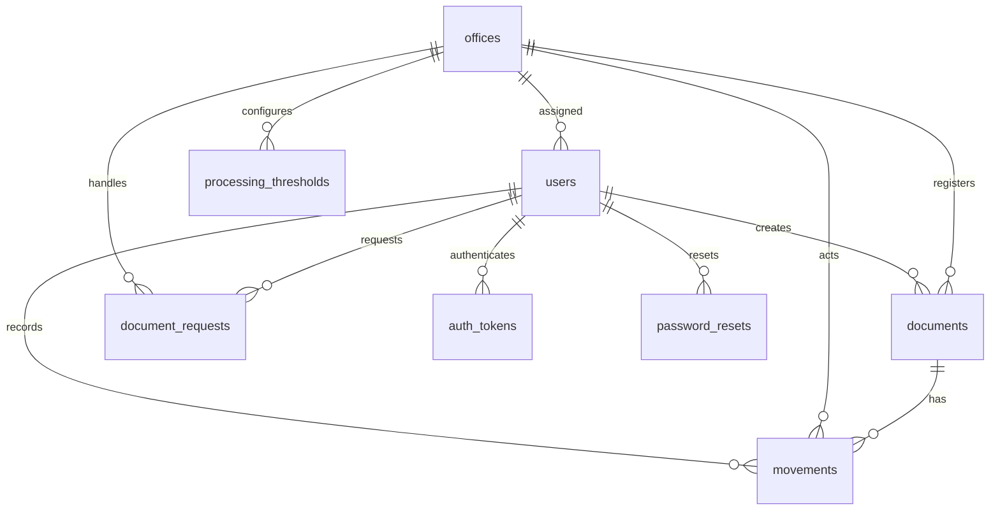

# SmartFlow Database Context

Source baseline: 2026-10-15. This document is based on checked-in SQL and PHP source, not a fresh dump of the running database. Deployed columns, indexes, constraints, row counts, and historical data quality require read-only inspection of the intended environment before relying on them.

The **16 October bounded stabilization** adds no schema migration. Signup/threshold transactions revalidate the current active admin and presented session with locking reads after resource waits, retaining authority locks through commit and rolling back ended sessions or lock conflicts. The existing ordered last-admin invariant is preserved. Municipal summary queries share one repeatable-read snapshot. System backup now imports its completed dump into an owned temporary restore schema before deriving manifest fingerprints and continuity-folder evidence; backup creation therefore requires create/drop permission and scratch capacity for one isolated import. Empty-folder snapshots verify with original-folder QR marked not applicable while still checking schema/data/key/uploads. Verification used synthetic fixtures and generated disposable schemas without selecting or mutating the operational database. See [implementation evidence](../.runtime/stabilization-2026-10-16/report.md); this does not prove atomicity across concurrent DDL and independently changing uploaded files or production recovery capacity.

## Runtime model and schema authority

SmartFlow uses MySQL through PDO, with InnoDB tables. Most runtime tables use `utf8mb4_unicode_ci`; `folder_checklists`, `movement_requests` and `creation_requests` specify InnoDB but inherit the database charset/collation. PHP and the SQL connection use the configured application timezone, defaulting to Asia/Manila. Local `DATETIME` values and Unix QR timestamps are both used; they must not be mistaken for interchangeable timezone formats. See [config.php](../backend/backend/api/config.php).

The sources are deliberately distinguished:

1. [api-schema.sql](../backend/backend/api-schema.sql) is the base schema for the current API. It contains eight runtime tables and seed office rows, but not every extension used by current endpoints.
2. [schema-bootstrap.php](../backend/backend/api/schema-bootstrap.php) runs through API configuration and creates/extends authentication, account, deadline, threshold and request structures. It also ensures pilot offices and threshold defaults. API startup and some nominally read-only endpoints can therefore write schema/default rows.
3. Feature helpers add logbook, QR, filing, contents, signup ownership-key, movement return-mode and request-closer columns, and movement/creation-recovery/checklist/correction tables when their endpoints are used. `CREATE TABLE IF NOT EXISTS` does not reconcile an already-created table's missing constraints or indexes.
4. Individual `*-migration.sql` scripts represent manual installation paths. Some use `USE smartflow`; several differ from PHP bootstrap. They are not a versioned migration ledger and must not be run indiscriminately against an existing database.
5. [schema.sql](../backend/backend/schema.sql) is a **thesis/design schema**, not the API schema. Its `roles`, `document_types`, `scan_logs`, `thresholds`, `alerts`, numeric document IDs and materialized document location/status do not describe the current runtime. Do not import it over an operational API database.

The initial context baseline was authored without an import, migration, seed, reset, purge or operational data change. Subsequent scoped local deployment/schema evidence belongs to the dated implementation reports, including the [follow-up remediation report](../.runtime/followup-remediation-report.md).

## Runtime tables

There are fourteen table definitions used by current source paths. Primary keys, declared foreign keys, and application relationships are different concepts; the following inventory keeps them separate.

### Core custody tables

| Table | Columns and meaning | Keys / declared base constraints |
|---|---|---|
| `offices` | `id INT UNSIGNED`, `name VARCHAR(100)`, `code VARCHAR(10)`; pilot office identities | Auto-increment PK `id`; unique `uk_offices_code(code)`. Name is not unique in the runtime schema. |
| `users` | `id`, `name VARCHAR(100)`, `username VARCHAR(50)`, nullable `email VARCHAR(120)`, `password_hash VARCHAR(255)`, `office_id`, `role VARCHAR(20)` default `staff`, `is_active` default 1, nullable `avatar_path VARCHAR(255)` | Auto-increment unsigned PK; unique username and nullable email; office index and FK to `offices.id`. No SQL role enum or role FK. |
| `documents` | `id VARCHAR(50)` tracking ID; `title VARCHAR(200)`; `type VARCHAR(50)`; `origin_office_id`; nullable `description TEXT`; `created_by`; `date_registered DATETIME`; nullable `folder_inventory LONGTEXT`, `qr_issued_at_unix BIGINT`, `filed_at DATETIME`, `filed_by` | PK `id`; origin index/FK; creator FK to `users.id`. No base FK for `filed_by`. No stored current-office/status column. |
| `movements` | Auto-increment `id`; `document_id VARCHAR(50)`; acting `office_id`; nullable effective `destination_office_id` for `OUT`; `status VARCHAR(10)`; `user_id`; nullable `remarks TEXT`, `contents_receipt LONGTEXT`, helper-added `is_return TINYINT(1)`; `scanned_at DATETIME` | PK; declared FKs to document, acting office and user. Status is validated as `IN`/`OUT` by API, not a base SQL `CHECK` or enum. Destination FK/index depends on installation path. New writes persist return mode; legacy NULL uses existing return-remarks recognition. |
| `movement_destination_corrections` | `id BIGINT UNSIGNED`; original `movement_id INT UNSIGNED`, `document_id VARCHAR(50)`; previous/new destination office IDs; `reason VARCHAR(1000)`; `corrected_by`, `corrected_by_office_id`; `corrected_at DATETIME` | PK; indexes `(movement_id,id)` and `(document_id,id)`; no declared FKs. Append-only application correction evidence, committed atomically with effective destination and recovery result. |

Base source: [api-schema.sql](../backend/backend/api-schema.sql); correction/return-mode extensions: [movement-corrections-helper.php](../backend/backend/api/movement-corrections-helper.php). Feature extension fields on `documents` are:

| Field | SQL type / storage | Purpose / source |
|---|---|---|
| `due_at` | Nullable `DATETIME` | Explicit folder deadline overrides calculated dwell/transfer deadline. [threshold helper](../backend/backend/api/thresholds-helper.php) |
| `reference_no` | Nullable `VARCHAR(100)` | Municipal reference/DV number; non-unique index added with the column. [logbook helper](../backend/backend/api/documents-logbook-helper.php) |
| `payee` | Nullable `VARCHAR(200)` | Required by API for DV registration; no database-level conditional requirement. |
| `fund_source` | Nullable `VARCHAR(100)` | Required by API for DV registration. |
| `received_from_office_id` | Nullable `INT UNSIGNED` | Required by API for ACC DV registration; logical office reference without a declared helper FK. |

`folder_inventory` records counted contents, not scans/PDFs of the papers. `qr_issued_at_unix` lets a stable signed label be reused until renewal is needed; there is no QR-token table. `filed_at/filed_by` record explicit filing of eligible non-fixed-route folders, while fixed-route completion is computed from movement history.

### Request and configuration tables

| Table | Important columns | Keys / constraints in PHP-created table |
|---|---|---|
| `document_requests` | `id INT UNSIGNED`; `request_code VARCHAR(24)`; `request_kind ENUM('access','pull')`; category `VARCHAR(30)`; `requested_by`; requester office and role snapshot; handler office; optional target office; `purpose TEXT`; nullable `required_by DATE`; optional `related_document_id`; status enum `pending/approved/rejected/fulfilled/cancelled`; separate `reviewed_*`/`review_notes`, `fulfilled_*`, and `cancelled_*` evidence; `created_at` | Auto-increment PK; unique request code; indexes `(handler_office_id,status)`, requester, required-by; declared FKs to requester user, requester office and handler office. Reviewer/closer/canceller and their office snapshots are logical references; helper additions declare no new FKs. See migration-path differences below. |
| `processing_thresholds` | `id`, `office_id`, `document_type VARCHAR(50)`, `max_hours` default 48, `out_unconfirmed_hours` default 24, `is_active`, auto-updated `updated_at` | PK; unique `(office_id,document_type)`; office FK. No FK to a document-types table. |
| `folder_checklists` | `id BIGINT UNSIGNED`; `office_id INT`; `name VARCHAR(100)`; `document_type VARCHAR(150)`; `items_json LONGTEXT`; `updated_by INT`; `is_active`; auto-updated timestamp | PK; `(office_id,is_active)` index. No declared office/user FKs or unique name. App validates ownership and distinct attachment names. |
| `movement_requests` | `request_id CHAR(32)`; `user_id INT`; `document_id VARCHAR(50)`; nullable `body_hash CHAR(64)` and `response_json LONGTEXT`; `state VARCHAR(12)`; created timestamp | Request-ID PK; `(user_id,created_at)` index. No declared document/user FKs or state enum. This is an idempotency/cancellation protocol, **not** `document_requests`. |
| `creation_requests` | `operation_id CHAR(32)`; `user_id INT`; `kind VARCHAR(12)` (`document`/`request` in API); `body_hash CHAR(64)`; nullable `response_json LONGTEXT`; created timestamp | Operation-ID PK; `(user_id,kind,created_at)` index. No declared user FK or kind enum. Result and new record commit together; this protocol is separate from ticket and movement tables. |

Sources: [request helper](../backend/backend/api/document-requests-helper.php), [threshold helper](../backend/backend/api/thresholds-helper.php), [checklist endpoint](../backend/backend/api/folder-checklists.php), [movement-recovery helper](../backend/backend/api/movement-requests-helper.php), and [creation-recovery helper](../backend/backend/api/creation-requests-helper.php).

### Identity and audit tables

| Table | Important columns | Keys / declared constraints |
|---|---|---|
| `signup_requests` | Applicant name, username/email, password hash, office/requested role; `request_code VARCHAR(20)`; helper-added nullable `status_key_hash CHAR(64)` and `approved_user_id INT`; status enum `pending/approved/rejected`; optional approver/time; created time | Unsigned auto-increment PK; unique username and request code; status index; office FK. No declared approver/approved-user FK or unique email here. Approval stores the created user's immutable ID. Ownership hashes/account bindings stay NULL on historical rows rather than being guessed from mutable usernames. |
| `auth_tokens` | Unsigned bigint ID, user, unique token hash `CHAR(64)`, expiry, `is_revoked`, optional IP/user-agent, created time | PK; unique token hash plus hash/user/expiry indexes; user FK with `ON DELETE CASCADE`. Hash stored, not the bearer token. |
| `password_resets` | Unsigned ID, user, token hash `VARCHAR(255)`, expiry, optional used-at, created time | PK; token-hash/user/expiry indexes; user FK with `ON DELETE CASCADE`. Token hash is indexed but not declared unique. |
| `audit_logs` | Unsigned bigint ID; `event_type VARCHAR(64)`; optional document/user/office/status; `outcome VARCHAR(20)`; `message VARCHAR(255)`; nullable `meta_json JSON`, IP/user-agent; created time | PK; `(event_type,created_at)`, `(document_id,created_at)`, `(user_id,created_at)` indexes. No FKs; rejected/unknown document references can be retained. |

Sources: [base schema](../backend/backend/api-schema.sql), [schema bootstrap](../backend/backend/api/schema-bootstrap.php), [signup ownership helper](../backend/backend/api/signup-status-helper.php), [token migration](../backend/backend/api/auth-tokens-migration.sql), [reset migration](../backend/backend/api/password-resets-migration.sql), and [audit helper](../backend/backend/api/audit-helper.php). Sensitive token/password material must never be copied into context docs, logs, examples, or screenshots.

## Relationships and derived values

This diagram shows the shared runtime FK relationships, not every logical reference. `documents.filed_by`, `documents.received_from_office_id`, `document_requests.target_office_id/reviewed_by/related_document_id`, `signup_requests.approved_user_id`, checklist owners/editors, movement-recovery owners/documents, and audit references have logical relationships; some are SQL FKs only in a particular installation path.

- Current custody is the last movement ordered by `scanned_at DESC, id DESC`. ID breaks equal timestamp ties. Latest `IN` identifies the holder; latest `OUT` identifies the sender and intended destination, not a confirmed receiving office.
- An unreceived OUT's `destination_office_id` is its current effective destination. Each correction preserves the prior/new destinations, reason, actor and office/time in `movement_destination_corrections`. Correction does not change the movement ID, sender, time or event counts. Readers use the effective destination for trays/receipt validation and attach correction evidence to journey/office-history rows.
- Office tray is derived as `in_office`, `incoming`, `forwarded`, or `completed`. An office queue includes latest activity at the office and transfers addressed to it; municipal scope includes all records. [Queue SQL](../backend/backend/api/office-queue-helper.php)
- Completion is derived from latest `IN`, visited office history, type, or explicit filing. DV completion at TRE after MAY may optionally reopen to transit toward ACC; Approved Budget completes at ACC after BUD. [Routing predicates](../backend/backend/api/routing-helper.php)
- Explicit named `Others:` types are excluded from financial inference before substring matching, including legacy leading spaces/tabs/newlines. PHP classification and SQL completion agree: financial office history cannot auto-complete those folders, while explicit staff filing can. Existing financial legacy rules and stored type values remain unchanged.
- Effective due date is explicit `documents.due_at`, otherwise latest scan plus the applicable active office/type threshold. Completion suppresses active due/overdue presentation. [Deadline helper](../backend/backend/api/thresholds-helper.php)
- Request overdue is computed for `pending` and `approved` tickets whose `required_by` is before the current calendar day. `required_by` remains nullable in SQL for compatibility, but create API requires it. [Request helper](../backend/backend/api/document-requests-helper.php)
- Current contents are the latest `IN` receipt with recorded contents, falling back to original inventory. No inventory is `unrecorded`. Contents and checklist item structures are JSON in `LONGTEXT`, validated by the application rather than SQL JSON constraints. [Contents helper](../backend/backend/api/folder-contents-helper.php)
- Alerts, aggregate counts, analytical/report rows and linked request presentation are computed queries, not runtime `alerts`, report or analytics tables.

## Indexes and uniqueness that matter

The base movement table declares separate document/office/user/time indexes and composites:

| Index | Columns | Meaning |
|---|---|---|
| `idx_movements_dedupe` | document, office, status, user, scanned-at | Query support only; it is **not unique**, so it does not prevent duplicates by itself. |
| `idx_movements_latest` | document, scanned-at, ID | Latest custody lookup. |
| `idx_movements_receipt` | document, status, scanned-at, ID | Latest recorded `IN` receipt lookup. |
| `idx_movements_office_time` | office, scanned-at, ID | Office activity/time queries. |

There is no unique reference-number, folder-title, folder-request-link, or one-active-folder-per-reference constraint. [Duplicate checking](../backend/backend/api/documents-duplicate-check.php) is advisory lookup, not a database uniqueness guarantee. There is no SQL `CHECK` that statuses alternate or that a movement's user is assigned to its acting office. These invariants depend on API validation and row locking.

## Installation-path drift and compatibility risks

| Path difference | Consequence |
|---|---|
| Base movements has `destination_office_id` but no destination FK/index; bootstrap adds those only when the column is absent | An import of the current base may lack destination constraints that an upgraded older database has. |
| [request migration](../backend/backend/api/document-requests-migration.sql) declares target/reviewer/document FKs and a created-at index; PHP creation omits them | Request referential guarantees depend on which path created the table. Bootstrap adds `required_by` when absent but does not reconcile those FKs/indexes. |
| Base documents includes inventory, QR and filing, but omits due/logbook fields | Base import alone is not the full current feature schema; helpers must run or deployment must explicitly provision extensions. |
| Older creator migration assigns existing folders to the earliest user if `created_by` was absent | Legacy creator attribution may be a migration fallback, not historically verified authorship. Do not present it as verified without review. |
| Most helpers add a missing column and its index together | A column already present does not prove its expected index/constraint exists. |
| Several manual SQL scripts hard-code a database name | They are not portable instructions for shared hosting or isolated test databases without review. |

These are known source differences, not confirmed defects in the user's current database. Before a schema change, obtain a read-only table/column/index/FK snapshot, preserve a restorable backup, compare actual state, and design an explicit migration. Do not replace live tables with either schema file.

## Transaction and invariant rules

### Registration and request links

[documents-create.php](../backend/backend/api/documents-create.php) prepares feature columns before the transaction, assigns a `DOC-YYYY-000001` ID using the current maximum sequence, and retries unique-key collisions up to five candidate IDs. The document, initial `IN`, QR issue timestamp, and optional approved-ticket link are committed as one transaction. Link failure rolls them back.

[smartflow_link_request_document](../backend/backend/api/document-requests-helper.php) locks the ticket `FOR UPDATE`, requires an approved ticket and handler/admin permission, checks category and handler origin/history evidence, and rejects replacement by a different document. Existing-document linking runs within its own transaction. There is no cross-ticket uniqueness restriction on the linked folder.

Request codes also use a yearly maximum sequence, protected by a unique SQL key; [request creation](../backend/backend/api/document-requests-create.php) now retries collisions up to five candidates. [Request updates](../backend/backend/api/document-requests-update.php) lock the ticket for every decision/link before validation/write. The returned revision hashes the current status/link/review/completion/cancellation fields rather than relying on a one-second timestamp. Supplied `expected_status`/`expected_revision` reject stale decisions with 409; legacy callers may omit them. Sequential conflict tests do not certify contention behavior under production load.

New `request_kind=pull` rows store `document_category=general` and the selected existing other office as handler/target, even when an older client supplies a stale allowed access category. By-type routing is unchanged. Historical pull rows are not migrated or reclassified; committed creation replay precedes new validation and returns its exact saved response, including the original category and deadline. These are application contract fixes with no schema migration or operational-record rewrite.

Closing reuses category/handler-origin-or-history validation for both existing and introduced links. Introducing a link also requires the accepted handler/admin linking authority; a different existing link cannot be replaced. `fulfilled_by` and `fulfilled_office_id` record the closer and their office at completion while preserving the original reviewer. Columns are added before business transactions. Legacy rows stay NULL rather than guessing the closer; Treasury's completed DV inbox membership uses the recorded Treasury office snapshot, not a user's later office assignment.

The [request evidence migration](../backend/backend/api/request-evidence-migration.sql) adds six nullable fields, also installed idempotently by the request helper before business transactions: unsigned `reviewed_office_id`, `cancelled_by` and `cancelled_office_id`; `cancelled_at DATETIME`; and `fulfilled_notes`/`cancelled_notes TEXT`. Approval/decline writes only review evidence; closing/cancellation writes only its own outcome evidence. The revision includes all three stages. No data backfill attempts to reconstruct overwritten legacy notes or infer offices from current user assignments. `review_notes_kind=legacy` marks old terminal mixed evidence; clients retain available recorded actor/time with an ambiguity label. Required evidence remains in the ticket transaction even if the auxiliary audit insert fails. See the [follow-up remediation report](../.runtime/followup-remediation-report.md).

### Creation operation recovery

Folder and ticket creation optionally accept a 32-character random hexadecimal operation ID. [The helper](../backend/backend/api/creation-requests-helper.php) canonicalizes and hashes the body excluding operation/token fields, locks the operation row and binds it to actor/kind/payload. Its successful JSON response commits with the new record. Same-operation replay returns that result; a different actor/kind/body is rejected. Committed replay is checked before time-sensitive validation, so a previously valid request does not become unrecoverable after its due date passes.

[Outcome lookup](../backend/backend/api/creation-requests.php) is owner/kind scoped and returns recorded/unknown. No retention or automatic cleanup policy for these rows is implemented. Operation IDs prevent replay duplicates for a submitted operation, not multiple separately identified registrations of the same physical folder; reference-number duplicate detection remains advisory. Old clients without an ID retain compatibility without this creation-replay protection.

The [polished-flow regressions](../scripts/final-flow-cases.php) exercise named Others registration/filing, SQL completion, financial legacy controls, pull role/category/target validation and new/historical replay. The complete guarded run passed 517 checks. All 90 source PHP files matched the isolated copy; information-schema metadata confirmed zero remaining harness databases. No live records were used or rewritten. See the [current report](../.runtime/polished-flow-report.md); deployment and native verification are tracked there separately.

### Movement writes and cancellation

[movements-create.php](../backend/backend/api/movements-create.php) locks the document `FOR UPDATE` before validating latest state and writing the event. Optional recovery request rows are locked first; their user/document/body hash prevents an ID from being reused for a different action. The movement and exact successful recovery response commit together. A replay of a recorded request returns the saved result, rather than inserting a second event.

Cancellation uses the same request-row lock and can create a `cancelled` tombstone before the movement arrives. A recorded event cannot be undone by cancelling its request. Without an idempotency ID, state validation plus the latest-event eight-second duplicate check still applies; the movement index itself is non-unique. These protections do not establish a general offline event queue.

System-originated actions must match `expected_movement_id`; system receipt must confirm actual physical receipt. `OUT` requires a valid different destination, current `IN` at sender, and permitted completion state. Returns require a previous holder and a reason. Recorded `IN` contents receipts must match immutable server inventory IDs and include confirmed actual counts.

### Filing, accounts, and auditing

- [Explicit filing](../backend/backend/api/documents-file.php) requires a positive displayed `expected_movement_id`, locks the document, compares the latest movement, checks current staff custody and non-fixed-route eligibility, updates only when unfiled, and commits. An intervening custody cycle invalidates the old ID even if the folder returns to the same office. Filing is not a movement.
- [Deadline editing](../backend/backend/api/documents-update-due.php) takes the same document lock as custody writers before reading latest movement/scope. It requires `expected_movement_id >= 0` and the raw nullable `expected_due_at`; no-movement 0 grants no guessed head office. Head scope remains the latest acting office, including an unreceived OUT; admin remains global. A changed movement or saved deadline rejects the write. Detail/queue reads expose raw `documents.due_at` as `manual_due_at` alongside calculated `due_at`; the guard must use the raw value. There is currently no client deadline setter to update.
- [Sign-up approval](../backend/backend/api/signup-approve.php) prepares ownership/email schema before its transaction, locks the pending request, inserts the user and records approval with the created immutable `approved_user_id` together. Username/email uniqueness failures return conflict, and a previously decided request is rejected. Rejection/reapplication does not retain an approved account binding.
- Feature `ALTER/CREATE` must happen before business transactions because MySQL DDL can implicitly commit. QR, contents and filing helpers used by custody endpoints follow that intent; verify any new helper placement.
- [Audit writes](../backend/backend/api/audit-helper.php) are best-effort and swallow failures. Successful movement audit is written after the custody transaction commits. The code therefore does **not** guarantee that every committed action has an audit row, even where an audit call appears inside a business transaction.
- Users are deactivated/reactivated, preserving movement attribution. Token/reset user references cascade on physical user deletion; ordinary custody FKs have no declared delete cascade. There is no normal operational document/user deletion workflow to assume from developer purge/reset scripts.

### Unreceived destination correction and session revocation

[movements-correct-destination.php](../backend/backend/api/movements-correct-destination.php) prepares correction/return-mode and recovery schema before its transaction. It locks the recovery request and document, validates the latest OUT plus displayed effective destination/latest correction ID, then appends a correction row, updates only the OUT destination and stores the recovery result atomically. A server-owned discriminator separates this operation from ordinary IN/OUT request replay. Receipt/movement writers take the same document lock, so a correction cannot validly act on a subsequently received state. Only sending-office staff may correct; filed/invalid-return/completed-route restrictions remain. There is no post-receipt correction, event deletion or fabricated receipt.

The correction table is required evidence within the business transaction; it is distinct from the best-effort `audit_logs` call after commit. Do not describe the entire audit system as immutable. A correction leaves transfer timing/counts unchanged and may reclassify which office has an incoming transfer. Legacy return-mode NULL rows remain supported via existing remarks rather than an invented historical flag.

New signup submissions generate a private status key and persist only its hash through [the ownership helper](../backend/backend/api/signup-status-helper.php). Existing requests retain NULL. Before approval, legacy status verifies the submitted credentials; after approval it uses the active account identified by `approved_user_id` and its current credentials. A request code plus current username/password supports legitimate account rename while preventing another account that reuses the old username from inheriting status access. Historical approved NULL-binding rows without a key require administrator assistance; bootstrap deliberately performs no username-based identity backfill. Status lookup never exchanges a public request code for a newly generated ownership secret.

[Logout](../backend/backend/api/auth-logout.php) revokes the presented token hash without deleting other sessions. [Password change](../backend/backend/api/users-change-password.php) locks/revalidates the user/session, updates the hash and revokes all user tokens in one transaction. [Deactivation](../backend/backend/api/users-set-active.php) updates the active flag and revokes tokens together; reactivation leaves those revocations in place. No new session-revocation table is introduced. The follow-up's guarded API harness passed **278 checks** and its generated database `smartflow_request_test_5bc253f7949a` was confirmed absent afterward. The client suites passed 32 web/103 Flutter tests; protected emulator review remains pending user sign-in. See the [follow-up report](../.runtime/system-gap-followup-report.md); these local tests do not establish actual production constraints or concurrency under load.

## Persistence outside MySQL

Avatar image files, application logs, rate-limit cache files and QR signing-key storage live outside these tables. A database-only backup does not preserve all application state. Backups/restoration should account for required uploads and signing-key continuity without exposing secrets in documentation; consult [backup scripts](../scripts/backup-system.ps1) and [backup verification](../scripts/verify-system-backup.ps1). Browser/mobile drafts and movement/creation recovery state also exist on clients and are not authoritative custody records.

## Open data decisions

- A complete, versioned migration strategy and canonical constraint set have not been established by the current files. Reconcile installation paths before claiming an exact deployed ERD.
- Client discovery requests fifteen-year retention, but no retention scheduler, legal-hold process, archival policy or deletion window is established here. Report date coverage is not retention enforcement.
- Confirm Budget completion/return requirements in [PRD.md](PRD.md) before changing derived statuses or schema. Staff-only custody writes are now implemented separately from head/admin request/checklist authority.
- Audit failure handling, real concurrent request/code contention, long-term movement/creation recovery-row cleanup and legacy attribution still need review. Earlier lock/replay regression evidence is recorded in the [priority fixes report](../.runtime/system-gap-fixes-report.md); destination-correction and session follow-up evidence is separate in the [follow-up report](../.runtime/system-gap-followup-report.md).
- Production database size, engine/version/sql mode, collation inheritance, query plans, backup recovery objectives and actual constraints are unknown until the intended environment is inspected.

For product vocabulary use [PRD.md](PRD.md); for application boundaries use [ARCHITECTURE.md](ARCHITECTURE.md); for security controls and test expectations use [SECURITY.md](SECURITY.md) and [TESTING.md](TESTING.md).
