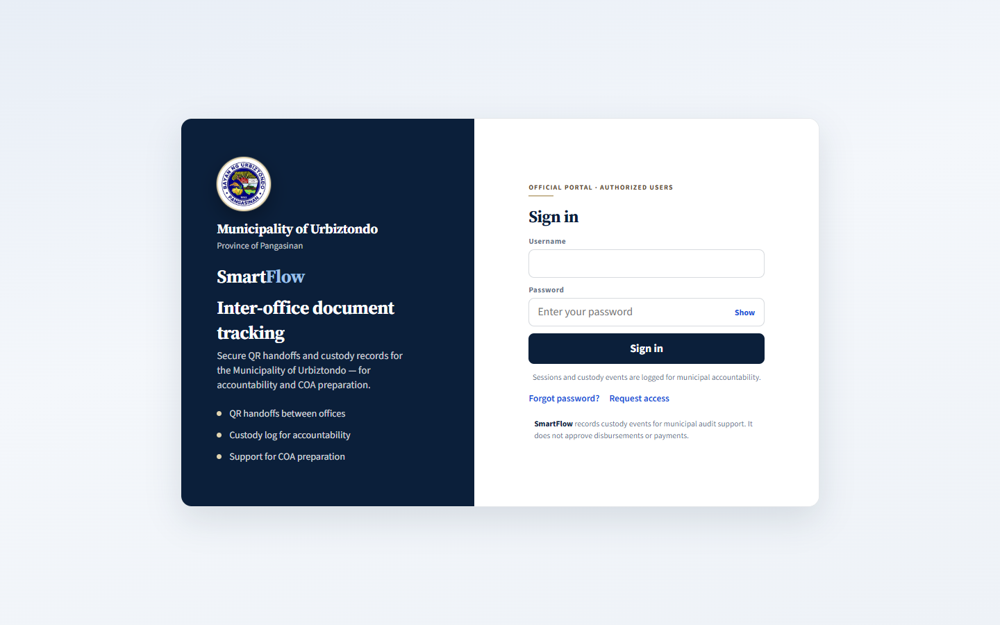
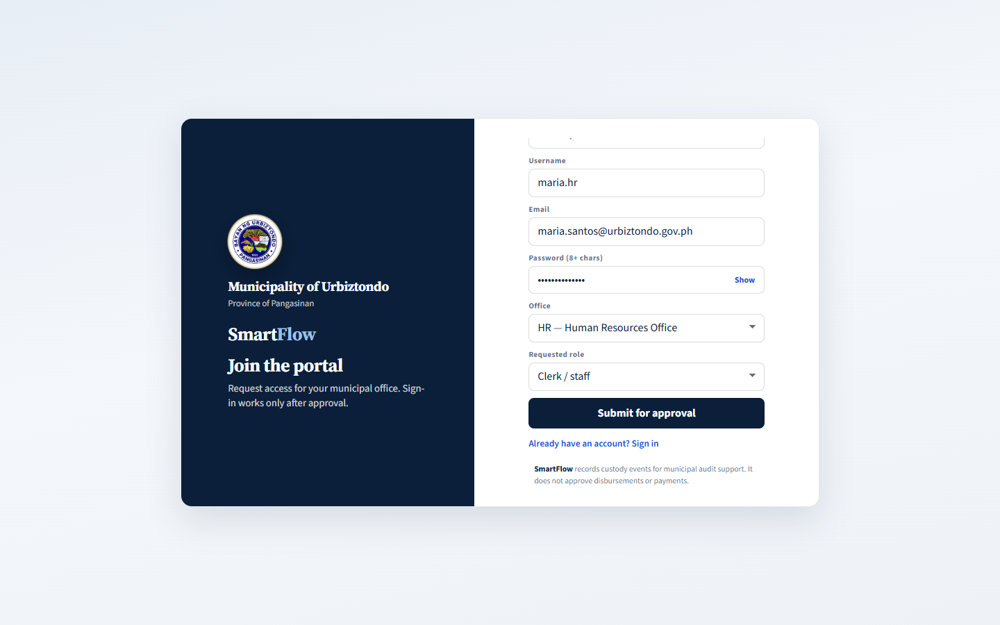
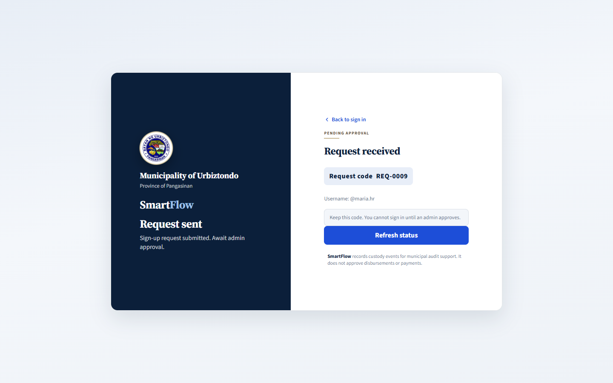
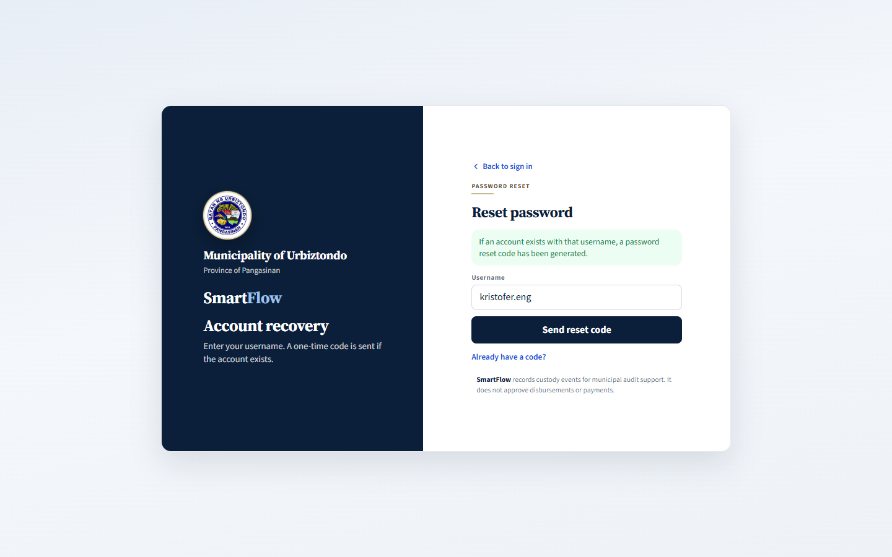
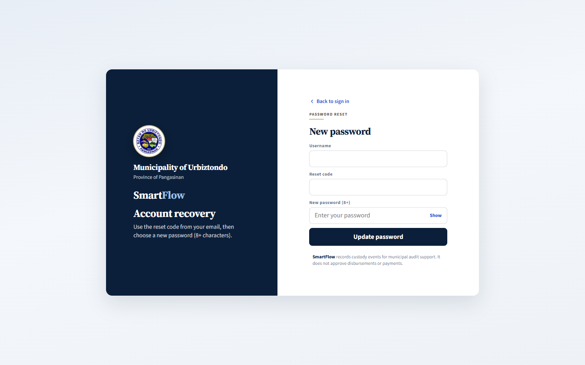
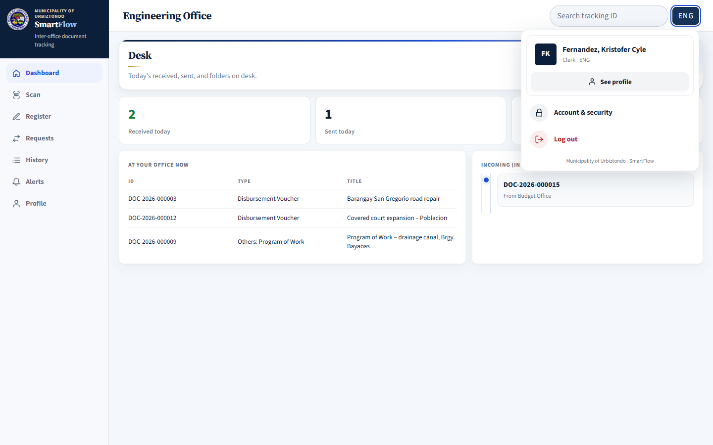
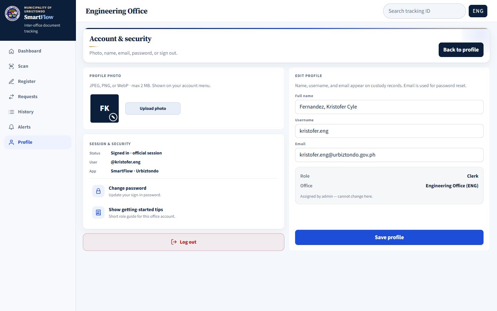

# SmartFlow User Manual — Part 1: Getting Started

**For:** everyone who uses SmartFlow (clerks, department heads, and the Municipal Accountant / Admin).

SmartFlow keeps a record of where each physical document folder is. Every time a folder arrives at or leaves an office, someone scans its QR label. SmartFlow then shows where the folder is now, how long it has been there, and the full path it took.

SmartFlow **does not** approve vouchers, release payments, or prepare financial statements. It only records the movement of the paper folder.

> The screenshots in this manual come from the SmartFlow web portal and show sample data. Names, document IDs, and numbers on your screen will be different.

---

## 1. The three things you do in SmartFlow

| If… | Use | What it does |
|---|---|---|
| The paper folder is **on your desk** and has no SmartFlow label yet | **Register** (called **New** on the phone) | Creates a tracking ID (for example `DOC-2026-000019`) and a QR label for the folder |
| A folder with a SmartFlow label **arrives** at or **leaves** your office | **Scan** → **Mark IN** or **Mark OUT** | Records the handoff: who, which office, and when |
| You need a file that is **in another office** | **Requests** | Sends a ticket to that office asking them to prepare or send it |

**The one rule to remember:** whoever physically holds the folder registers it and scans it. If the folder is not with you yet, send a **Request** — do not register it.

---

## 2. Offices and roles

**Offices in SmartFlow**

| Code | Office |
|---|---|
| ENG | Engineering Office |
| HR | Human Resources Office |
| BUD | Budget Office |
| ACC | Accounting Office |
| TRE | Municipal Treasury |
| MAY | Office of the Mayor |

**Roles**

| Role | Who | Can do |
|---|---|---|
| **Clerk** (staff) | Frontline staff of an office | Register, scan, requests, history, and alerts for their own office |
| **Department Head** | Head of one office | Everything a clerk can do, plus the office queue and monthly analytics |
| **Municipal Accountant / Admin** | Municipal Accountant (system administrator) | Municipal dashboard, approve accounts, offices, time limits, COA reports, QR scan monitor, system status |

Each account belongs to **one office**. Your role and office are set by the Admin; you cannot change them yourself.

---

## 3. Opening SmartFlow

You can use SmartFlow in two ways:

- **Web portal** — open the SmartFlow address given by your LGU IT in Chrome or Edge on a computer.
- **Android app** — install the SmartFlow app provided by your LGU IT on your phone. The phone camera is the fastest way to scan QR labels.

Both use the same account and the same records.

---

## 4. Signing in

1. Enter your **Username** and **Password**.
2. Click **Sign in**.
3. SmartFlow opens your home screen based on your role.

Your session lasts up to **24 hours**. After that, sign in again.

Common sign-in messages:

| Message | Meaning |
|---|---|
| *Invalid username or password* | Check spelling and Caps Lock. Use **Forgot password?** if needed. |
| *Account pending admin approval…* | Your access request has not been approved yet. See section 5. |
| *This account has been deactivated…* | The Admin turned off your account. Contact the Municipal Accountant / Admin. |

---

## 5. Requesting an account (new users)

1. On the sign-in screen, click **Request access**.
2. Fill in **Full name**, **Username**, **Email**, and **Password** (at least 8 characters).
3. Choose your **Office** and **Requested role** (*Clerk / staff*, *Department head*, or *Municipal accountant / admin*).
4. Click **Submit for approval**.

5. Write down your **Request code** (for example `REQ-0009`).
6. Click **Refresh status** later to check whether the Admin has approved you.

You **cannot sign in** until the Admin approves your request. If your request is rejected, you may correct your details and submit again.

---

## 6. Forgot your password

1. On the sign-in screen, click **Forgot password?**
2. Enter your **Username** and click **Send reset code**.
3. Check the email address registered to your account for a **6-digit code**. The code is valid for **1 hour**.

4. Enter your **Username**, the **Reset code**, and a **New password** (at least 8 characters).
5. Click **Update password**, then sign in with the new password.

For security, SmartFlow shows the same message whether or not the username exists.

---

## 7. Finding your way around

**Web portal:** the menu is on the left side. The **Search tracking ID** box at the top right opens the history of any document. Click your office badge (top right) for **See profile**, **Account & security**, and **Log out**.

**Android app:** the main screens are tabs at the bottom. Other screens are under **Menu**.

| Role | Bottom tabs | Under Menu |
|---|---|---|
| Clerk | Home · Scan · Alerts · Menu | Register document · History · Document requests |
| Department Head | Home · Queue · Alerts · Menu | Scan · Register document · Analytics · History · Document requests |
| Admin | Home · History · COA · Menu | Users · Alerts · Offices · Thresholds · QR scan monitor · System · Document requests |

**Help inside the app:** tap the **?** in the top bar (or **Menu → How to use this page**) for short steps about the screen you are on. A short role guide also appears the first time you sign in; reopen it from **Account & security → Show getting-started tips**.

---

## 8. Your profile and password

Open **Account & security** to:

- upload a profile photo (JPEG, PNG, or WebP, up to 2 MB),
- edit your full name, username, and email (your email is used for password reset),
- **Change password**,
- **Log out**.

Your **Role** and **Office** are shown but can only be changed by the Admin.

**Always log out** on shared computers.

---

**Next:** read the guide for your role.

- [Part 2 — Clerk (Staff) Guide](02-clerk-guide.md)
- [Part 3 — Department Head Guide](03-department-head-guide.md)
- [Part 4 — Municipal Accountant / Admin Guide](04-admin-guide.md)
- [Part 5 — Troubleshooting](05-troubleshooting.md)
