# SmartFlow User Manual — Part 2: Clerk (Staff) Guide

**For:** clerks of Engineering, HR, Budget, Accounting, Treasury, and the Office of the Mayor.

As a clerk, you are the person who keeps SmartFlow in step with the paper folders: you register folders that start at your desk, and you scan folders when they arrive or leave.

Read [Part 1 — Getting Started](01-getting-started.md) first if you have not signed in before.

---

## 1. Your daily routine

1. **Start of day:** open **Home** and check **Incoming (in transit)** — these folders are on their way to you.
2. **When a folder arrives:** **Scan → Mark IN** right away.
3. **When a folder leaves:** **Scan → Mark OUT** and choose the receiving office *before* you hand it over.
4. **New folder that starts at your desk:** **Register**, then print and attach the QR label.
5. **Before going home:** open **Alerts** and act on anything **Overdue**.

---

## 2. Home (Desk)

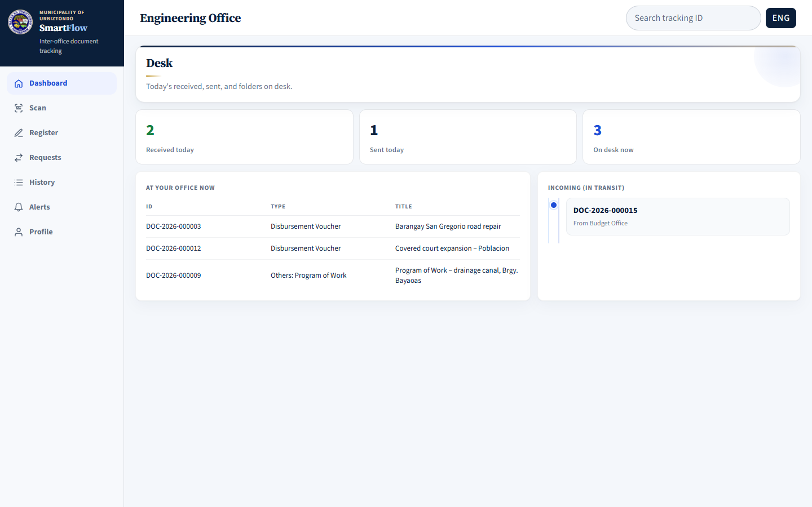

| Part | What it shows |
|---|---|
| **Received today** | Folders you marked IN today |
| **Sent today** | Folders you marked OUT today |
| **On desk now** | Folders physically at your office right now |
| **At your office now** | List of those folders (ID, type, title) |
| **Incoming (in transit)** | Folders another office has sent to you that you have not marked IN yet |

---

## 3. Registering a new folder

Register **only** when the paper folder is already in your hands. Registering creates the tracking ID and QR label, and SmartFlow automatically records the folder as **IN** at your office.

Do **not** register a folder just to ask another office for it — use **Requests** instead (section 5).

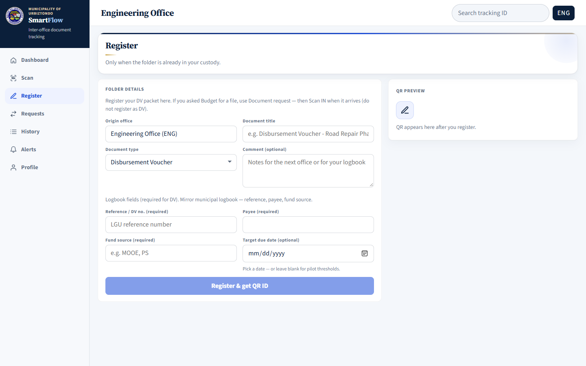

1. Open **Register** (on the phone: **Menu → Register document**).
2. Fill in the form:
   - **Document title** — a clear name, for example *Disbursement Voucher – Road Repair Phase 2*.
   - **Document type** — only the types your office handles are shown (see the table below).
   - **Comment** (optional) — notes for the next office or your logbook.
   - **Logbook fields:**
     - *Disbursement Voucher:* **Reference / DV no.**, **Payee**, and **Fund source** are required.
     - *Approved Budget:* **Reference** is required.
   - **Target due date** (optional) — leave blank to use the office time limit set by the Admin.
3. Click **Register & get QR ID**.

**Document types per office**

| Office | Can register |
|---|---|
| Engineering (ENG) | Disbursement Voucher |
| Budget (BUD) | Approved Budget |
| Accounting (ACC) | Disbursement Voucher, Approved Budget |
| Treasury (TRE) | Disbursement Voucher |
| Mayor (MAY) | Disbursement Voucher |
| Human Resources (HR) | Others only (payroll folders are not tracked by QR) |

Every office can also choose **Others** and type a name for the folder (at least 3 characters).

**Accounting clerks:** Accounting does not start project DVs. Register a DV only if it arrived **without** a SmartFlow label, and choose the office it came from under **Received from office**.

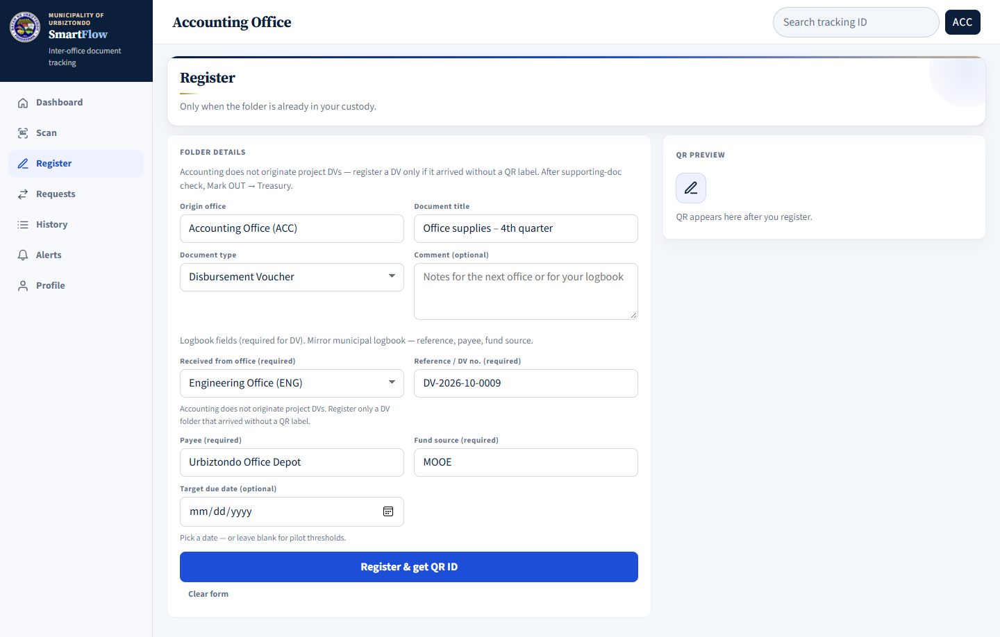

**If the reference number was already used,** SmartFlow warns you and shows the existing document. Click **Cancel** and check the existing record first. Click **Register anyway** only if this really is a different folder.

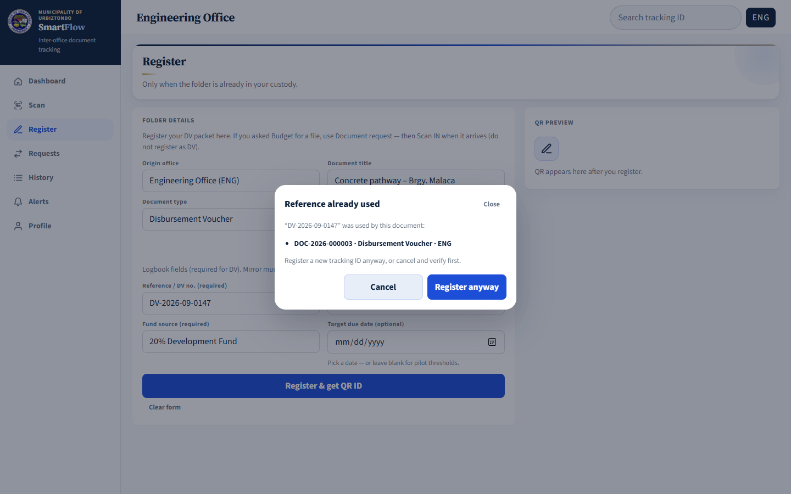

### After registering

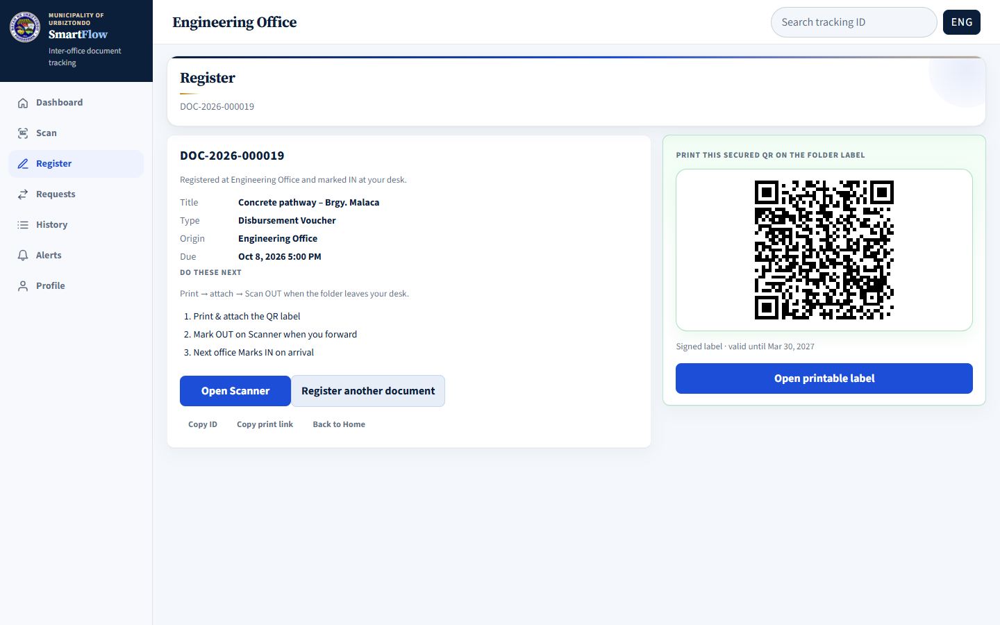

1. Click **Open printable label** and print it. You can also click **Copy print link** and open it on another computer, but the link only works for the rest of your sign-in session (up to 24 hours). Do not share it outside the office.
2. Attach the label to the folder. Also write the tracking ID (for example `DOC-2026-000019`) on the folder.
3. When the folder leaves your desk, **Scan → Mark OUT** (section 4).

The QR label is digitally signed and valid for about **6 months** (the expiry date is shown under the QR). Do not edit or photocopy-alter the label.

---

## 4. Scanning: Mark IN and Mark OUT

Scanning is the official handoff record. Always scan **at the moment** the folder changes hands.

### Find the folder


Open **Scan** and use any one of these:

- **Use camera** — point the camera at the QR label (fastest on the phone).
- **Upload QR image** — choose a photo of the label.
- **Tracking ID or QR text** — type the ID (for example `DOC-2026-000015`) and click **Look up**.

The right side shows the folder: type, ID, title, and where it is now.

### Mark IN (folder arrived)

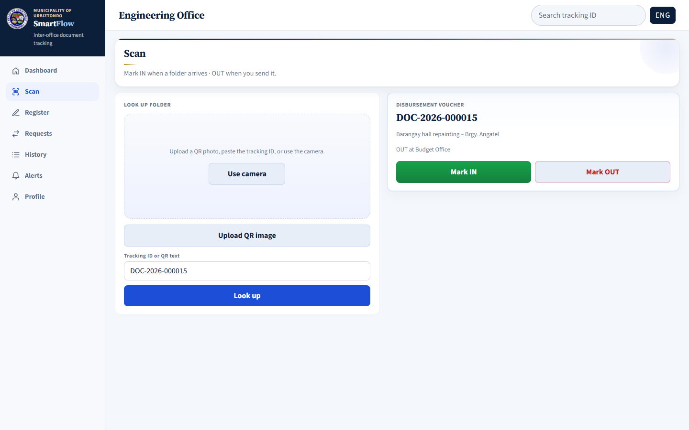

Click **Mark IN**. You can only mark IN a folder that was sent **to your office**.

### Mark OUT (folder leaving)

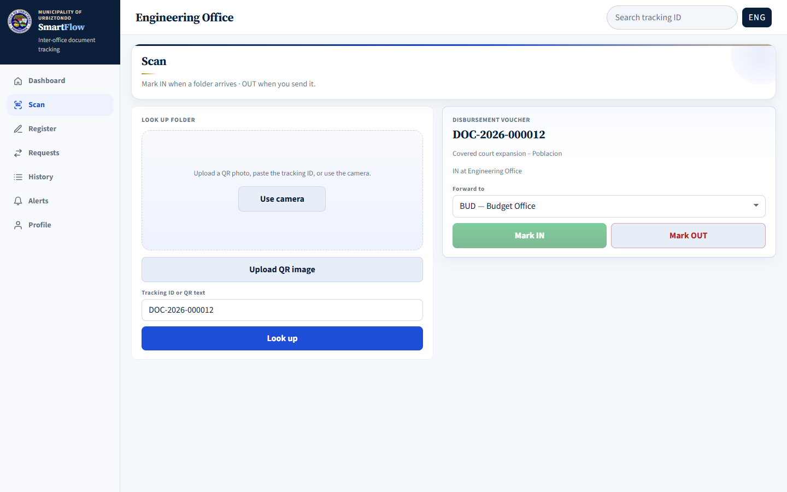

1. Under **Forward to**, choose the receiving office. SmartFlow pre-selects the usual next office, but you can change it.
2. Click **Mark OUT**, then hand over the folder.

Only the office you chose can mark the folder IN next.

### Return a folder (incomplete or needs correction)

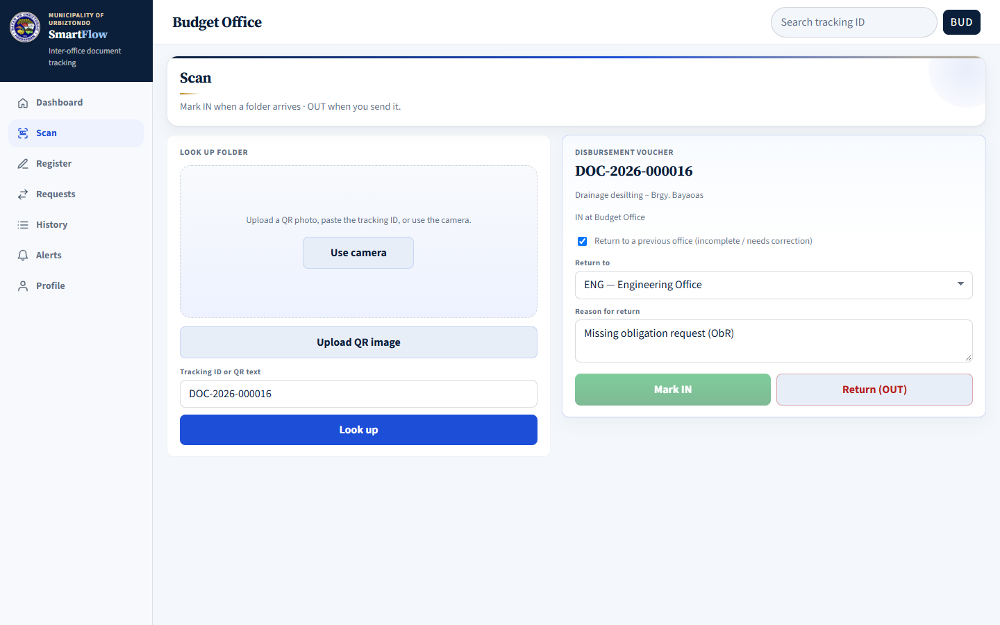

1. Tick **Return to a previous office (incomplete / needs correction)**.
2. Choose the office under **Return to**.
3. Type the **Reason for return** (required), for example *Missing obligation request (ObR)*.
4. Click **Return (OUT)**.

The reason appears in the document's history.

### Usual route of a Disbursement Voucher

```
Engineering → Budget → Accounting → Treasury → Office of the Mayor → Treasury
```

When the folder is back at Treasury after the Mayor, the trail is complete (Treasury checks the release). If the folder goes back to Accounting for filing, Treasury marks it OUT to Accounting.

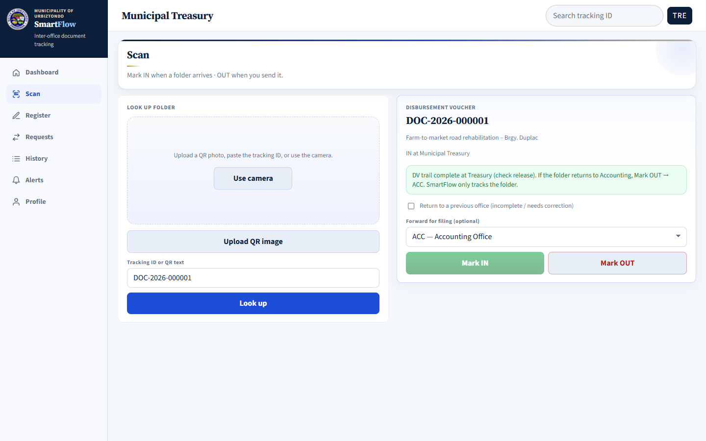

Approved Budgets usually go **Budget → Accounting**.

### Scan rules SmartFlow enforces

- You cannot mark IN a folder that is still IN at another office. That office must mark it OUT first.

  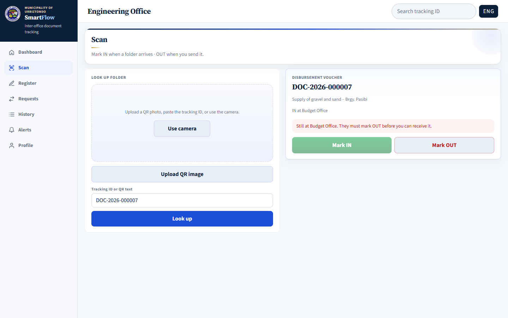

- You cannot mark IN twice. If it is already IN at your office, mark it OUT when you forward it.
- You cannot mark OUT a folder that is not IN at your office.
- A damaged, edited, or expired QR label is rejected and logged.

  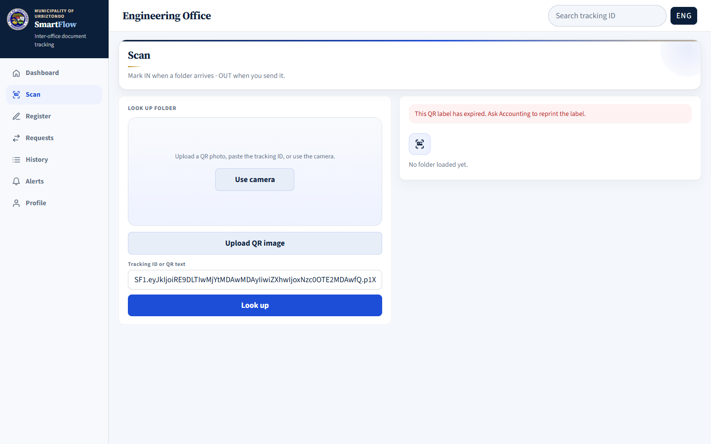

See [Part 5 — Troubleshooting](05-troubleshooting.md) for what to do with each message.

---

## 5. Document requests

A request is a ticket: *"please prepare or send this file."* Accepting a request does **not** move any folder — the office that holds the folder still registers and scans it.

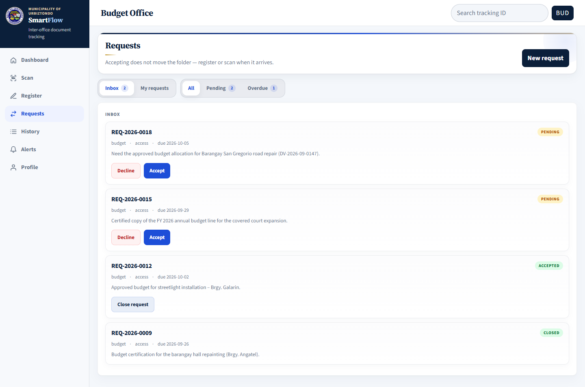

- **Inbox** — requests sent **to your office**.
- **My requests** — requests **you** sent.
- Filters: **All**, **Pending**, **Overdue** (past the required-by date).

### Send a request


1. Click **New request**.
2. Choose the **Kind**:
   - **By type (Budget / DV / Others)** — then choose the **Document type**:
     - *Budget (→ BUD)* goes to the Budget Office.
     - *Disbursement / DV (→ ACC)* goes to the Accounting Office.
     - *Others* — you also choose which office.
   - **From office (pull)** — ask a specific office to send you a file, and choose the **Target office**.

   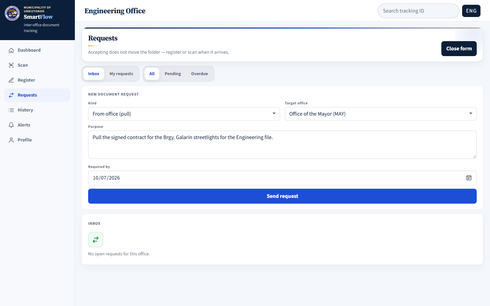

3. Type the **Purpose** (required). Mention the DV or reference number if you have it.
4. Choose the **Required by** date (required).
5. Click **Send request**.

You cannot send a request to your own office.

### Track your requests

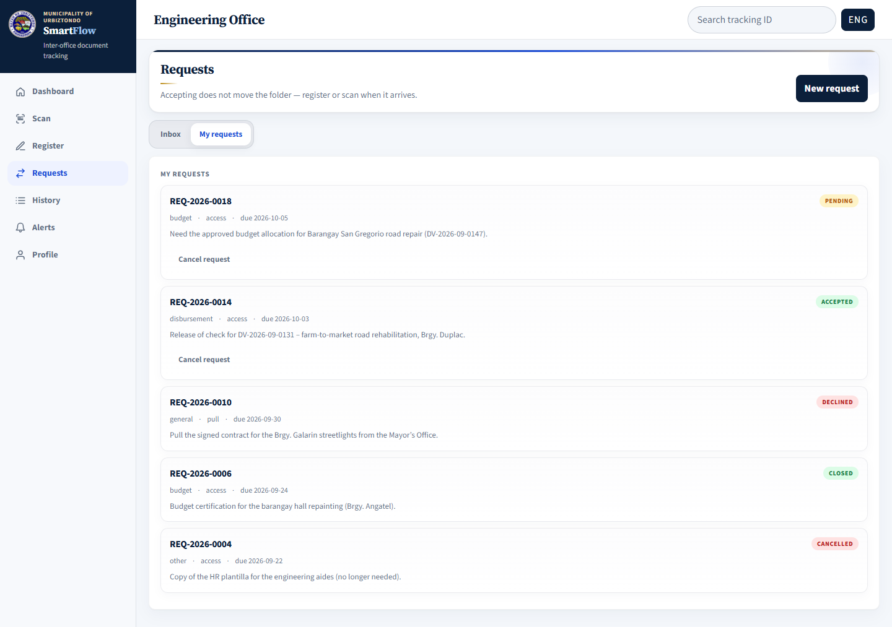

| Status | Meaning |
|---|---|
| **Pending** | Waiting for the other office to accept or decline |
| **Accepted** | The other office is working on it |
| **Declined** | The other office declined (their reason is recorded) |
| **Closed** | Done |
| **Cancelled** | You cancelled it |

Click **Cancel request** if you no longer need a pending or accepted request.

### Handle requests sent to your office (Inbox)

- **Accept** — your office will work on it.
- **Decline** — type the **Decline notes** (required). You must **also** inform the requester separately by phone call or memo.

  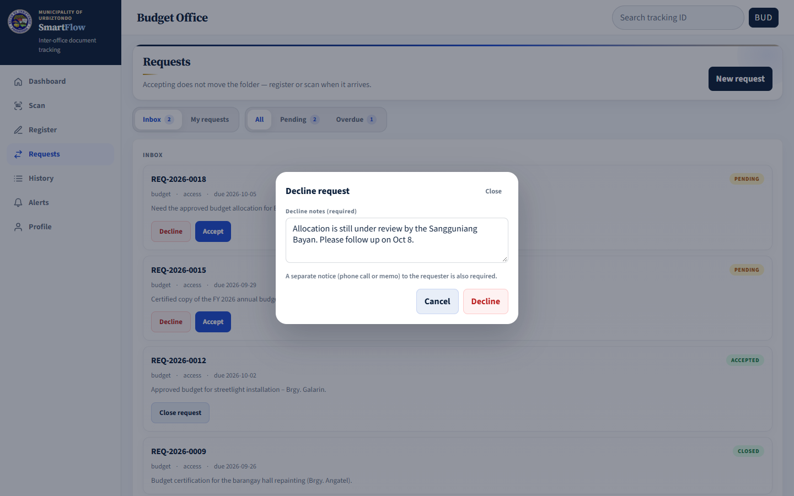

- **Close request** — when the work is done. You may enter the **Related document ID** (for example the DOC ID of the folder you sent) and closing notes.

  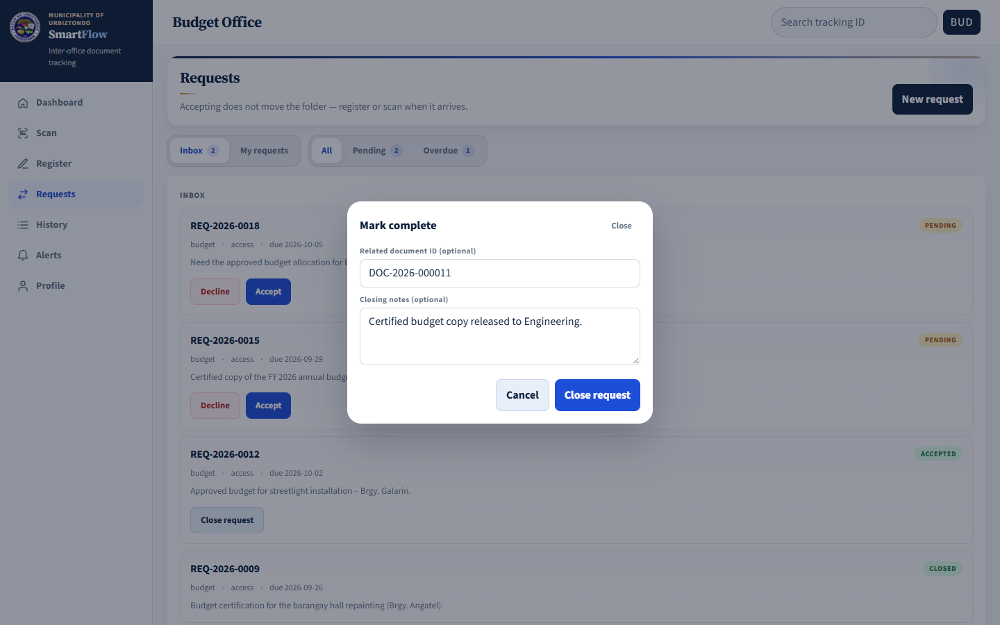

**Disbursement requests:** Accounting accepts the request. When payment is released, **Treasury** clicks **Mark payment released** to close it.

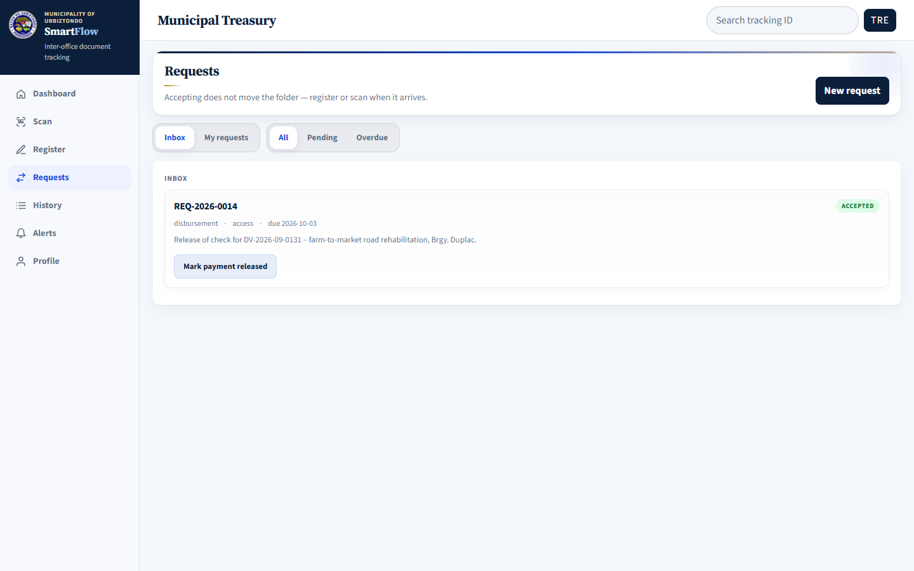

---

## 6. History

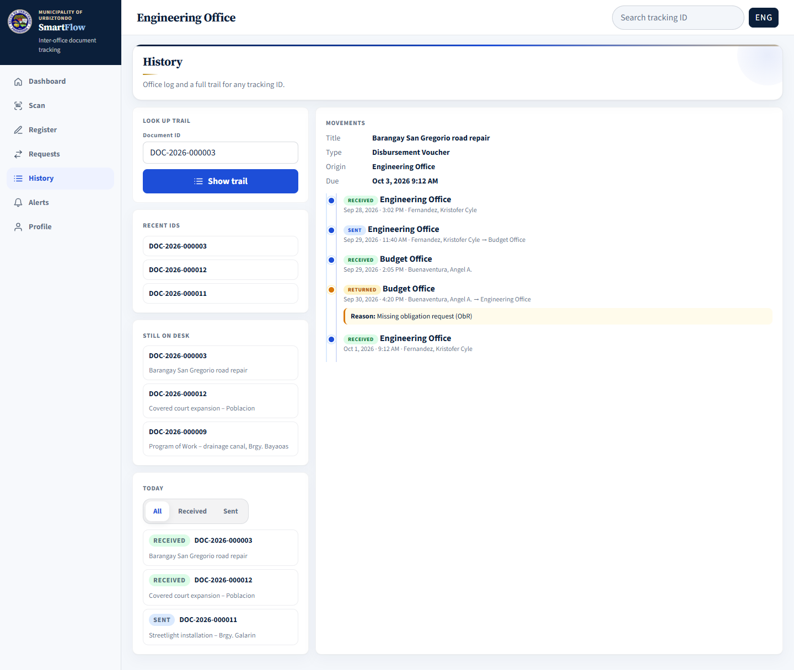

1. Open **History** (on the phone: **Menu → History**), or type an ID in **Search tracking ID** at the top.
2. Enter the **Document ID** and click **Show trail**.
3. Read the movements from top to bottom: **Received** (IN), **Sent** (OUT), and **Returned** (with the reason), each with the office, date and time, and the person who scanned.

The left side also lists **Recent IDs**, folders **Still on desk**, and **Today's** received and sent folders.

---

## 7. Alerts

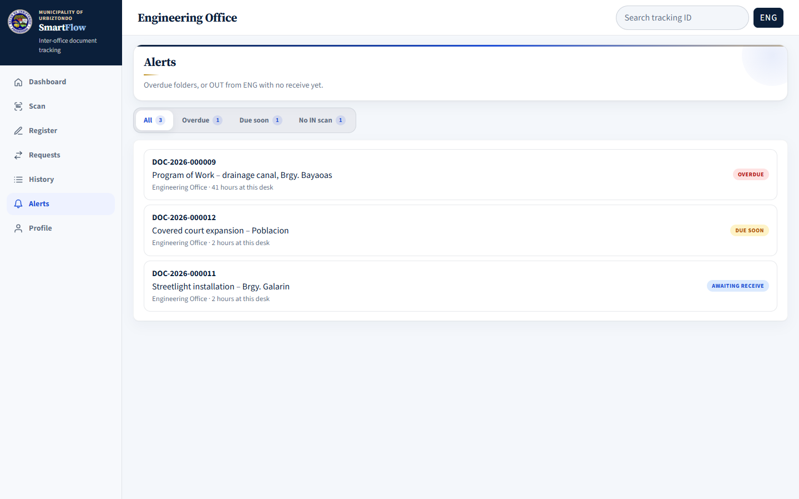

Alerts show folders in **your office** that need attention:

| Label | Meaning | What to do |
|---|---|---|
| **Overdue** | The folder has stayed at your office longer than the time limit | Process and forward it, or tell your Department Head why it is delayed |
| **Due soon** | Close to the time limit | Prioritize it |
| **Awaiting receive** (filter: *No IN scan*) | You marked it OUT but the receiving office has not marked it IN | Call the receiving office and ask them to scan it IN |

Delays at other offices appear on their own Alerts, and on the Admin's municipal view.

---

## 8. Good habits

- Scan **every** handoff, at the moment it happens. A skipped scan breaks the trail.
- Always choose the correct **Forward to** office before handing over a folder.
- Never register a folder that is not physically with you.
- Keep QR labels clean and flat. If a label is damaged or expired, see [Troubleshooting](05-troubleshooting.md).
- Log out on shared computers.
