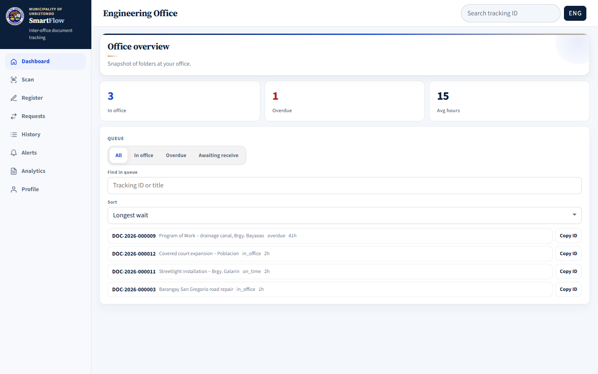
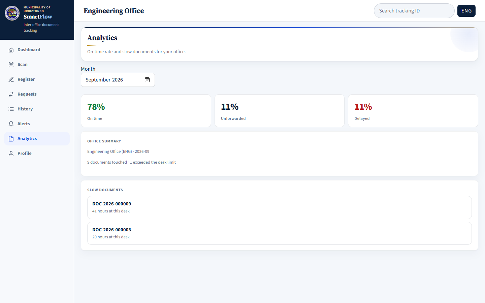

# SmartFlow User Manual — Part 3: Department Head Guide

**For:** heads of Engineering, HR, Budget, Accounting, Treasury, and the Office of the Mayor.

As a Department Head, you monitor the folders in **your office only**: what is waiting, what is overdue, and how fast your office forwards documents. You can also register and scan when you personally handle a folder.

Read [Part 1 — Getting Started](01-getting-started.md) first if you have not signed in before.

---

## 1. Your routine

1. **Daily:** open **Home** (the Office overview) and filter the queue by **Overdue**. Follow up with the clerk responsible.
2. **Daily:** check **Alerts** and the **Requests** inbox for anything pending.
3. **Monthly:** open **Analytics** to review your office's on-time rate and slow documents.

---

## 2. Office overview (Home)

| Part | What it shows |
|---|---|
| **In office** | Folders currently at your office |
| **Overdue** | Folders past the time limit at your office |
| **Avg hours** | Average time folders stay at your office |
| **Queue** | List of folders with ID, title, status, and hours at your office |

Use the queue tools:

- Filters: **All**, **In office**, **Overdue**, **Awaiting receive** (sent out but not yet marked IN by the next office).
- **Find in queue** — search by tracking ID or title.
- **Sort** — for example **Longest wait** first.
- **Copy ID** — copy a tracking ID to look up its full **History**.

On the Android app, the queue is the **Queue** tab.

---

## 3. Analytics

1. Open **Analytics** (on the phone: **Menu → Analytics**).
2. Choose the **Month**.
3. Review:
   - **On time** — share of folders forwarded within the time limit.
   - **Unforwarded** — folders sent out but not yet received by the next office.
   - **Delayed** — folders that stayed longer than the time limit.
   - **Office summary** — how many documents your office handled and how many exceeded the limit.
   - **Slow documents** — the folders that stayed longest at your office.

Use this in staff meetings to spot recurring delays.

---

## 4. Alerts, Requests, and History

These work the same way as for clerks — see the [Clerk Guide](02-clerk-guide.md):

- **Alerts** — Overdue, Due soon, and Awaiting receive folders for your office (Clerk Guide section 7).
- **Requests** — accept, decline, or close requests sent to your office, and send your own (Clerk Guide section 5). When you decline, also inform the requester by phone or memo.
- **History** — the full movement trail of any folder (Clerk Guide section 6).

---

## 5. Registering and scanning

Clerks normally handle registration and scanning. Use these yourself only when **you** are physically holding the folder.

- **Register** follows the same steps and rules as the [Clerk Guide, section 3](02-clerk-guide.md#3-registering-a-new-folder). After registering, assign a clerk to attach the QR label and scan the folder when it is forwarded.
- **Scan → Mark IN / Mark OUT** follows the same rules as the [Clerk Guide, section 4](02-clerk-guide.md#4-scanning-mark-in-and-mark-out).

If the folder is not with your office yet, send a **Request** — do not register someone else's folder.

---

## 6. What a Department Head cannot do

Only the Municipal Accountant / Admin can approve accounts, change offices or time limits, view the municipal dashboard, generate COA reports, or open the QR scan monitor. Ask the Admin if you need any of these.

You see **only your own office's** folders and figures.
