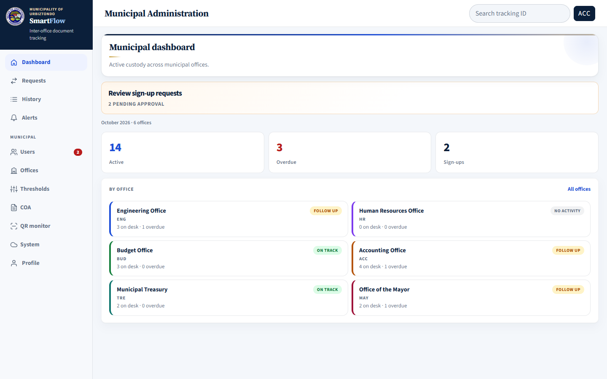
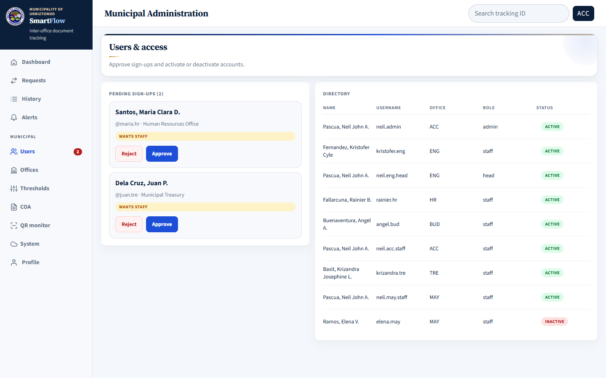
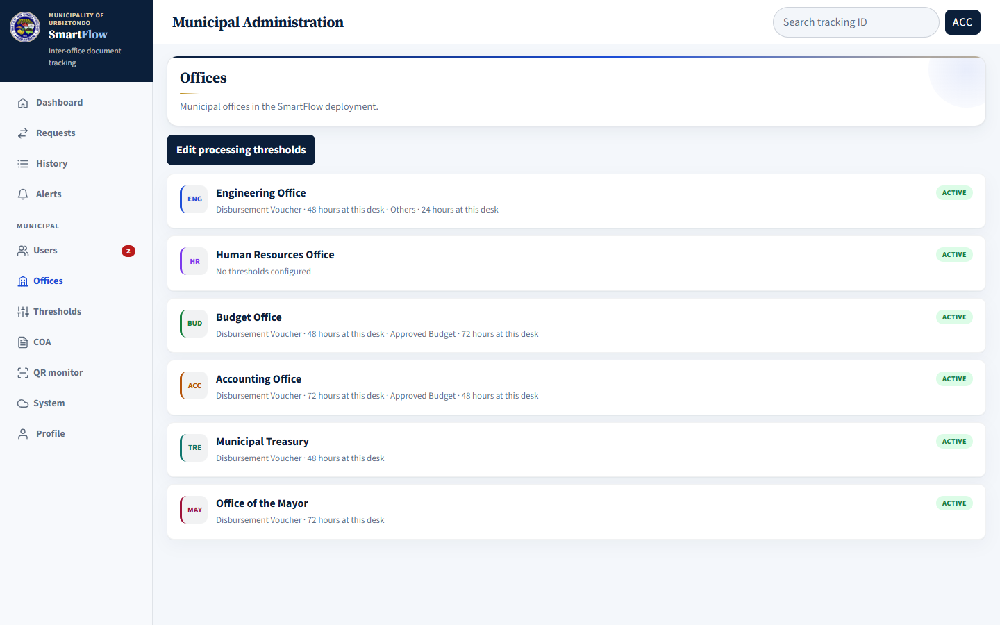
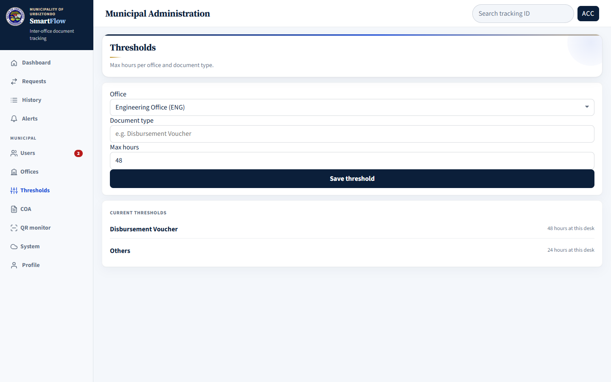
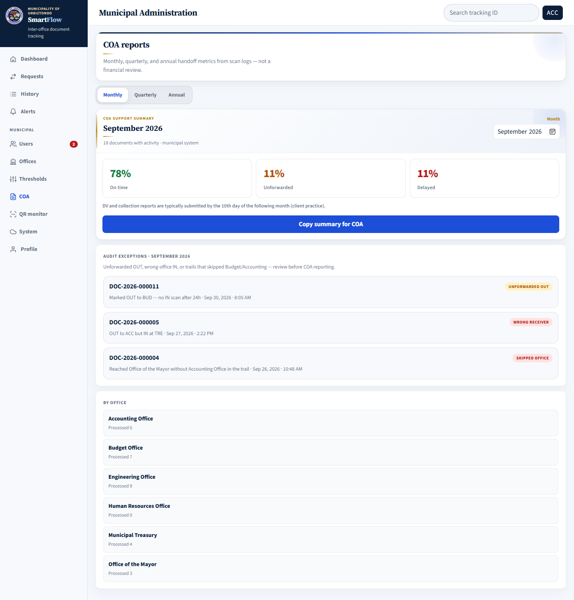
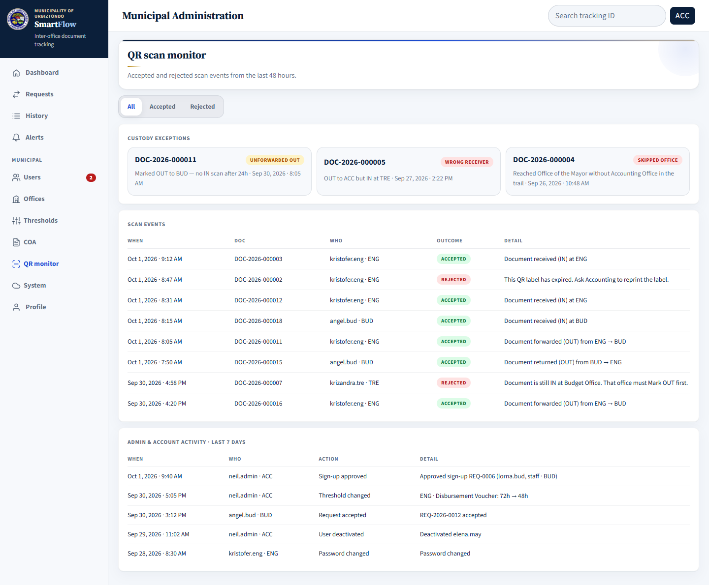
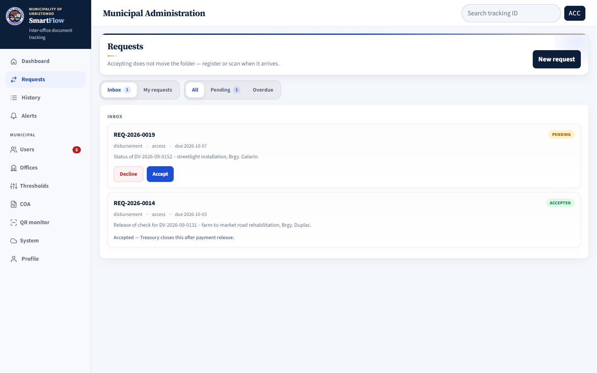
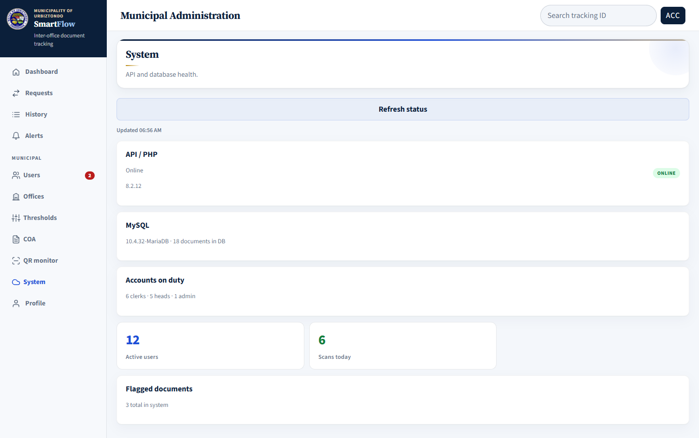

# SmartFlow User Manual — Part 4: Municipal Accountant / Admin Guide

**For:** the Municipal Accountant, who is also the SmartFlow system administrator.

The Admin account is for **oversight**: municipal-wide monitoring, user accounts, time limits, COA support reports, and audit checks. It does **not** show Scan or Register in its menu.

Everyday Accounting handoffs (Mark IN / Mark OUT of folders at the Accounting Office) are done with a separate **Accounting clerk account**. If you scan folders yourself, sign in with that clerk account and follow the [Clerk Guide](02-clerk-guide.md).

Read [Part 1 — Getting Started](01-getting-started.md) first if you have not signed in before.

---

## 1. Your routine

| When | Do |
|---|---|
| **Daily** | Check the **Municipal dashboard** for overdue folders and pending sign-ups |
| **Daily** | Approve or reject new **sign-up requests** under **Users** |
| **Weekly** | Review **QR monitor** for rejected scans and custody exceptions |
| **Monthly** (before the 10th) | Open **COA** reports for the previous month, review audit exceptions, then copy the summary |
| **When needed** | Adjust **Thresholds**, deactivate accounts of staff who left, check **System** status |

---

## 2. Municipal dashboard (Home)

| Part | What it shows |
|---|---|
| **Review sign-up requests** | Appears when people are waiting for approval — click it to open **Users** |
| **Active** | Folders currently being tracked across all offices |
| **Overdue** | Folders past their office time limit |
| **Sign-ups** | Pending account requests |
| **By office** | One card per office: folders on desk, overdue count, and a status label |

Office status labels: **On track** (nothing overdue), **Follow up** (has overdue folders), **No activity** (nothing on desk).

The **Users** menu item shows a red number when sign-ups are waiting.

---

## 3. Users and access

### Approve or reject sign-ups

Each pending card shows the person's name, username, office, and requested role (for example **wants staff**).

1. Confirm that the person really works in that office and needs that role.
2. Click **Approve** to create an active account, or **Reject** to decline.

Once approved, the person can sign in right away. A rejected person may correct their details and request again.

### Deactivate or reactivate an account

The **Directory** lists every account with its office, role, and status.

- Click the **Active** label of a person to **deactivate** them (for example, staff who resigned or transferred). They can no longer sign in, but their past scans stay in the records.
- Click the **Inactive** label to **reactivate** the account.

SmartFlow will not let you deactivate **your own account** or the **last active Admin account**.

### Changing a person's office or role

SmartFlow has no screen for changing the office or role of an existing account. If a person transfers to another office or changes role:

1. Deactivate the old account.
2. Ask the person to **Request access** again with a new username, the new office, and the new role.
3. Approve the new request.

The old account's history is kept.

---

## 4. Offices

Lists the six municipal offices in SmartFlow (ENG, HR, BUD, ACC, TRE, MAY), with the time limit for each document type. Click **Edit processing thresholds** to change those limits.

---

## 5. Thresholds (time limits)

A threshold is the maximum number of hours a folder of a given type may stay at an office. Folders that stay longer become **Overdue** in Alerts, dashboards, and reports.

1. Choose the **Office**.
2. Type the **Document type** exactly as it appears in SmartFlow, for example `Disbursement Voucher`, `Approved Budget`, or `Others`.
3. Enter the **Max hours** (for example `48`).
4. Click **Save threshold**.

**Current thresholds** shows the limits for the selected office. Every change is recorded in the activity log (QR monitor).

If a clerk sets a **Target due date** when registering a folder, that date is used for that folder instead of the office threshold.

---

## 6. COA reports

These reports summarize **folder handoffs** from scan records to support COA preparation. They are **not** a financial review and do not replace the Accounting Office's financial reports.

1. Choose **Monthly**, **Quarterly**, or **Annual**.
2. Choose the period (for example *September 2026*).
3. Review the figures:
   - **On time** — handoffs completed within the time limit.
   - **Unforwarded** — folders marked OUT but never marked IN by the next office.
   - **Delayed** — folders that stayed longer than the time limit.
4. Review **Audit exceptions** before reporting:
   - **Unforwarded OUT** — marked OUT, but no IN scan after 24 hours.
   - **Wrong receiver** — sent to one office but marked IN at another.
   - **Skipped office** — the trail skipped a required office (for example, reached the Mayor without passing Accounting).

   Follow up each exception with the offices involved and check the folder's **History**.
5. **By office** shows how many documents each office processed.
6. Click **Copy summary for COA** to copy a text summary that you can paste into your report or memo.

Reminder shown in SmartFlow: DV and collection reports are typically submitted by the **10th day of the following month**.

---

## 7. QR scan monitor (audit)

Use this to check that handoffs follow the rules and to answer audit questions.

| Section | What it shows |
|---|---|
| **Custody exceptions** | The same exceptions as in COA reports (unforwarded, wrong receiver, skipped office) |
| **Scan events** | Accepted and rejected scans from the **last 48 hours**: when, document, who, outcome, and detail |
| **Admin & account activity** | The **last 7 days** of sign-up approvals, threshold changes, request decisions, deactivations, and password changes |

Use the **All / Accepted / Rejected** filter. Rejected scans show why SmartFlow blocked them, for example an expired QR label or a folder that was still at another office.

---

## 8. Requests, History, and Alerts

- **Requests** — disbursement requests come to the Accounting Office inbox. **Accept** them; Treasury then clicks **Mark payment released** to close them. Declining needs a reason and a separate phone or memo notice. See the [Clerk Guide, section 5](02-clerk-guide.md#5-document-requests).

  

- **History** — look up the full trail of any document in any office.
- **Alerts** — late folders across all municipal offices.

---

## 9. System status

Shows whether SmartFlow is working: **API / PHP** online, **MySQL** database, accounts on duty, active users, scans today, and flagged documents. Click **Refresh status** to check again.

If the API or database is not online, users cannot scan or register. Contact your LGU IT.

---

## 10. Admin responsibilities

- Approve only people who belong to the office they selected.
- Deactivate accounts of staff who resign or transfer **on their last day**.
- Consider approving a **second Admin account** for a trusted person, so the system can still be managed when the Municipal Accountant is away.
- Ask LGU IT to back up the SmartFlow database regularly.
- Never share the Admin password. Each person uses their own account so the records show who did what.
