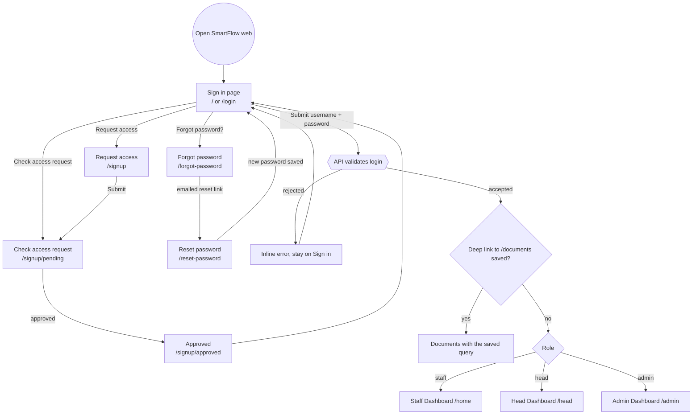
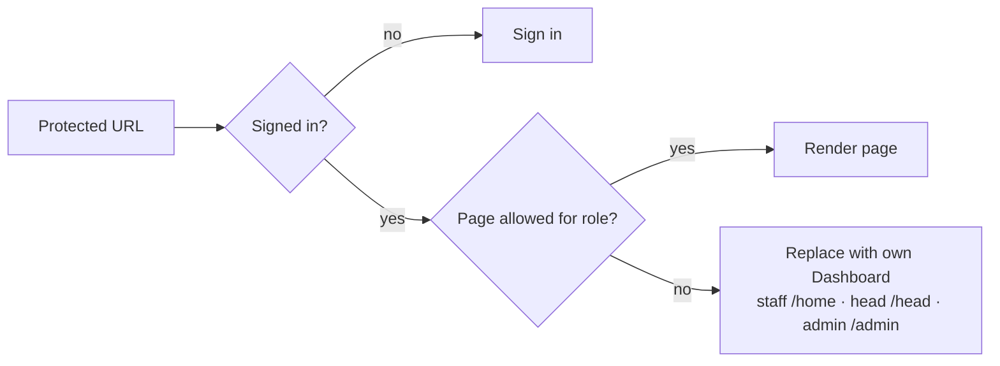
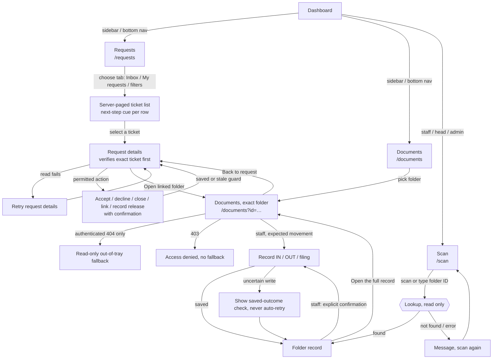

# Web user flow — sign in → Dashboard → Requests → Documents → Scan

Status: **derived from source** (`web/src/App.jsx`, `LoginPage.jsx`, `tracking.js`, `RequestsPage.jsx`, `ScanPage.jsx`) on 19 October 2026. It has not yet been walked in the browser, so treat it as a map of intended routing, not acceptance evidence. Web only; phone web and native are out of scope.

Goal: a signed-in person moves from the sign-in page to their own Dashboard, then through Requests, Documents and Scan without leaving their role's allowed pages. Route guards are client convenience only; the API remains the authorization boundary.

Legend: rectangle = screen, diamond = decision, rounded = action, hexagon = system step.

## 1. Sign in and landing

Notes
- An unauthenticated visit to any protected page redirects to `/`. Only a `/documents…` target is remembered and restored after sign-in.
- Unknown paths (`*`) redirect to `/`.
- **Expired session (tested 19 Oct):** an invalid token on any protected request clears the stored login and returns to Sign in, where the API text "Missing or invalid token" is shown.
- **Walked in the browser 19 Oct** with staff (ENG, BUD), head (ACC) and admin test accounts: sign in → Dashboard → Requests (create, accept, close, cancel) → Documents (OUT, IN with page count, filing) → Scan page, plus role guards. See `WEB-UX-OBJECTIVES-2026-10-18.md` for observations.
- **Not yet tested:** forgot password with a real email (it writes to the database and sends email; ask before running), and Decline of a request.

## 2. Role guard on every protected page

| Page | staff | head | admin |
|---|---|---|---|
| Dashboard | `/home` | `/head` (+ `/head/analytics`) | `/admin` |
| Requests, Documents, Scan, History, Alerts, Profile | yes | yes | yes |
| Register | yes | redirected | redirected |
| Users, Offices, Thresholds, Custody reports, QR monitor, System | redirected | redirected | yes |

Registration, IN/OUT and filing remain staff-only on the API; the guard here only mirrors that.

## 3. Main working path

Notes
- Looking up a folder (Scan or Documents) verifies it only. A physical handoff is recorded by the confirmed IN, OUT or filing action, never by accepting or linking a request.
- Requests keeps tab, filter, search, page and selection in its URL, so Back to request restores them.
- Linked-folder fallback only after an authenticated 404; a 403 is never bypassed.
- Head and admin see Scan and Documents as monitoring only on the client; this is presentation, not server authorization.

## 4. Sign out

Profile menu → Sign out revokes the presented session on the server, then returns to `/`. Password change or deactivation also revokes sessions; reactivation does not revive old tokens.

## Open items
1. Walk sections 1–3 in the browser and record any difference from this map.
2. Test expired session and forgot password (needs the user's go-ahead).
3. Objective 3 viewport acceptance of Requests is separate (see `WEB-UX-OBJECTIVES-2026-10-18.md`).
