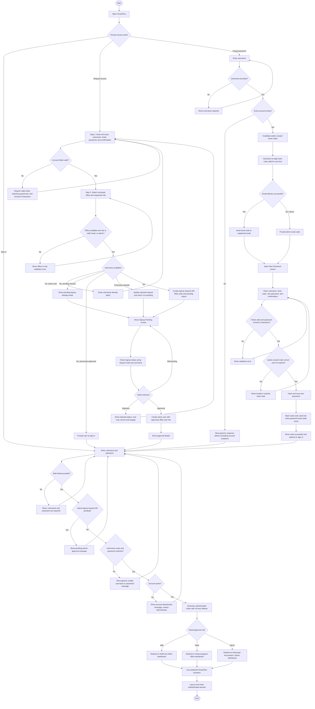

# SmartFlow Authentication and Access Flow — As Implemented

This is a separate authentication figure. It does not replace or modify the Staff, Head, or Admin operational flowcharts.

## Verified Rules

- Login uses `username` and `password`.
- Pending signup requests cannot sign in.
- Deactivated accounts cannot sign in.
- Successful login creates a token with a 24-hour lifetime.
- Role redirect is `staff → /staff`, `head → /head`, and `admin → /admin`.
- Signup requires full name, unique username, valid email, password of at least eight characters, confirmation, office, and requested role.
- New accounts remain pending until Admin approves them.
- A rejected signup can be corrected and resubmitted using the same request record.
- Password reset uses a six-digit code that expires after one hour.
- Password-reset responses do not reveal whether a username exists.
- Successful password reset invalidates the code and records an audit event.

