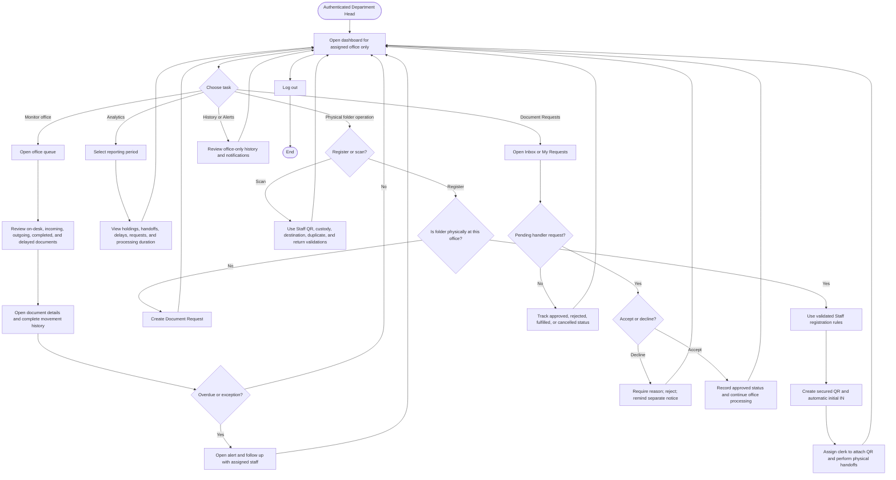

# Figure 2-5B — Department Head Flowchart

Source of truth: implemented Flutter screens, PHP API validation, client-discovery summary, and the 2026-09-28 system test report.

## Verified Notes

- A Department Head is restricted to one assigned office.
- Head can use Register and Scan under the same validation rules as Staff.
- Head does not manage users, offices, thresholds, audit exceptions, or municipal COA reports.
- The implemented system has no standalone Signatory Request module.

