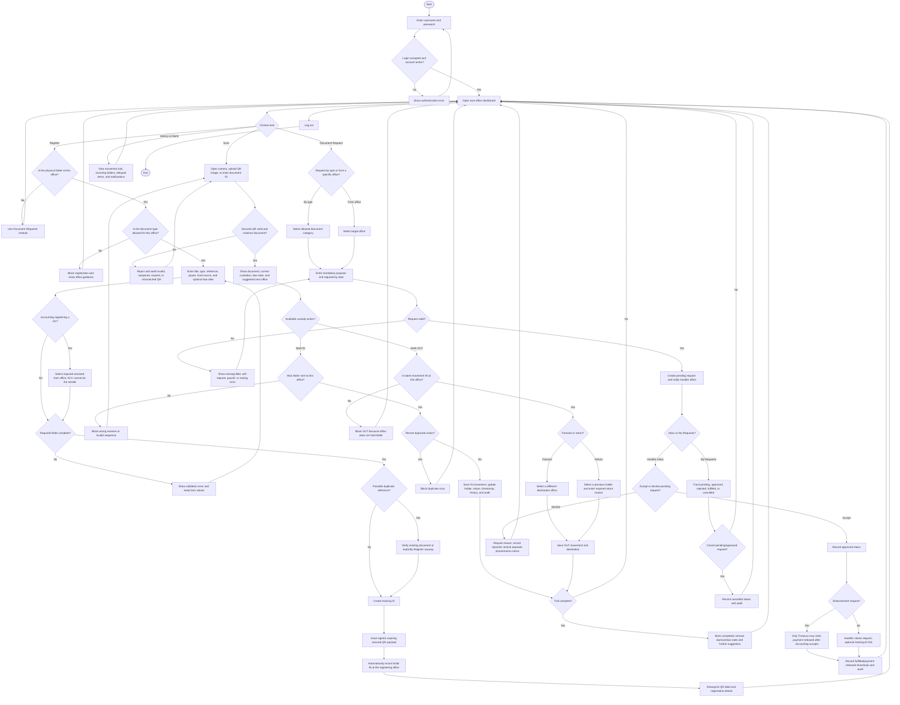
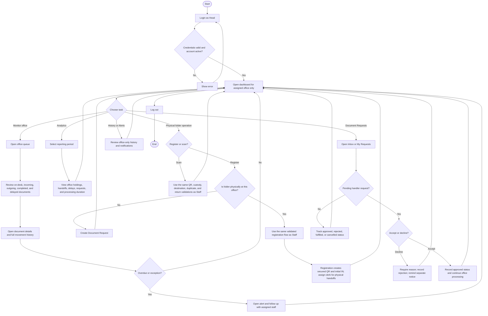
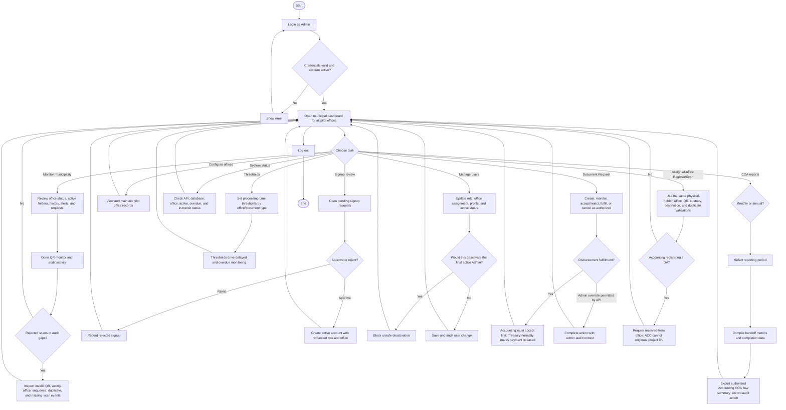

# SmartFlow Role Flowcharts — As Implemented

Source of truth: Flutter routes and screens, PHP API authorization and validation, client-discovery summary, and the 2026-09-28 system test report.

## Figure 2-5A — Staff / Clerk

Implementation notes:

- Staff sees only the assigned office's operational data.
- HR cannot register payroll folders in Phase 1.
- `OUT` always requires a destination. Only that destination can record the next `IN`.
- Completed DV route: ENG → BUD → ACC → TRE → MAY → TRE → ACC.

## Figure 2-5B — Department Head

Implementation notes:

- A Head is restricted to one assigned office.
- Head can use Register and Scan, but does not manage users, offices, thresholds, audit exceptions, or municipal COA reports.
- The implemented app has no separate production Signatory Request module.

## Figure 2-5C — Municipal Accountant / Admin

Implementation notes:

- The live `admin` role combines Municipal Accountant monitoring/reporting with system administration.
- Contrary to an older demo note, current routes and APIs allow Admin to register and scan for the assigned office.
- Admin actions are audited. SmartFlow records payment-release status but does not approve financial transactions or produce financial statements.

