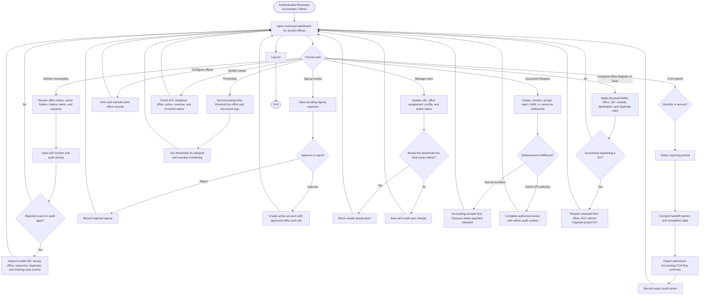

# Figure 2-5C — Municipal Accountant / Admin Flowchart

Source of truth: implemented Flutter screens, PHP API validation, client-discovery summary, and the 2026-09-28 system test report.

## Verified Notes

- The live `admin` role combines Municipal Accountant and System Administrator functions.
- Current routes and APIs allow Admin to Register and Scan for the assigned office.
- Admin actions are audited.
- SmartFlow records payment-release status but does not approve financial transactions or produce financial statements.

