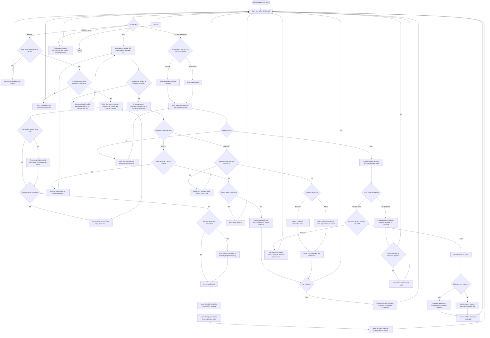

# Figure 2-5A — Staff / Clerk Flowchart

Source of truth: implemented Flutter screens, PHP API validation, client-discovery summary, and the 2026-09-28 system test report.

## Verified Notes

- Staff sees operational data for the assigned office only.
- Registration automatically creates the initial `IN` movement.
- `OUT` requires a destination; only that destination may record the next `IN`.
- HR payroll-folder registration is excluded from Phase 1.
- Completed DV route: `ENG → BUD → ACC → TRE → MAY → TRE → ACC`.

