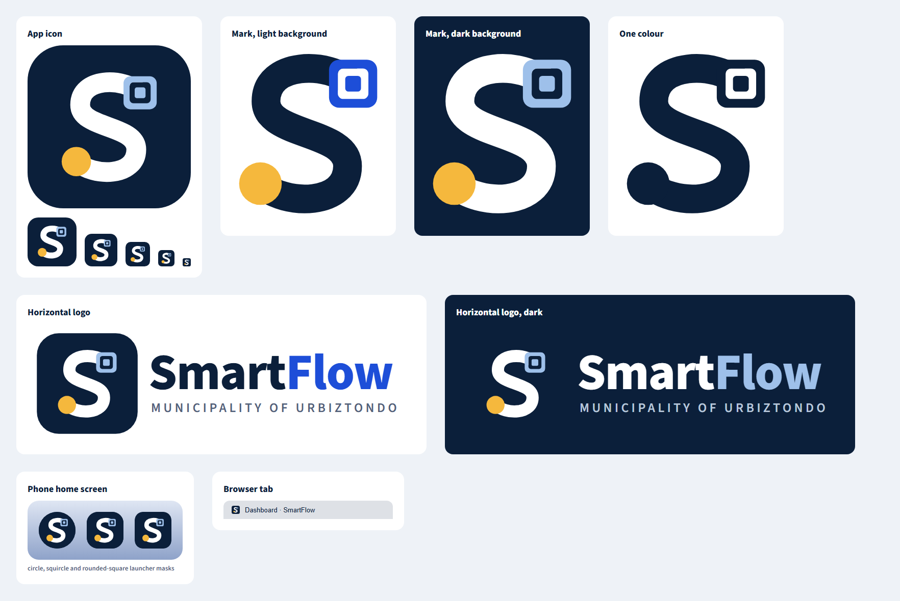

# SmartFlow logo

## The idea

The mark is an **S drawn as one route**. It starts at a gold dot, the office that sends a folder, and ends in a **QR finder square**, the tagged folder arriving. "Smart" is the QR tag, "Flow" is the path between offices. It stays readable at 16 px, where it still looks like an S with a dot.

The municipal seal is separate. Keep using it as the municipality's identity (it is in the app header); this logo is the product's identity.

## Files

| File | Use |
|---|---|
| `svg/smartflow-app-icon.svg` | The app icon: mark on a navy rounded square. Web favicon, store listings, social previews. |
| `svg/smartflow-app-icon-square.svg` | Same, full bleed with no rounded corners. Use where the system rounds the corners itself (iOS, Android adaptive background). |
| `svg/smartflow-icon-foreground.svg` | Android adaptive icon foreground: transparent, inside the safe circle. Pair with navy `#0B1F3A`. |
| `svg/smartflow-mark.svg` | The mark alone, for **light** backgrounds. |
| `svg/smartflow-mark-light.svg` | The mark alone, for **dark** backgrounds. |
| `svg/smartflow-mark-mono.svg` | One colour (navy). Stamps, fax, single-colour print. Change the fill for white. |
| `svg/smartflow-logo-horizontal.svg` | Mark, "SmartFlow" and "Municipality of Urbiztondo" for light backgrounds. |
| `svg/smartflow-logo-horizontal-dark.svg` | The same for dark backgrounds. |
| `png/` | Ready-made PNGs: app icon at 1024, 512 and 192 px (transparent corners), full-bleed 1024, the marks at 1024 px wide and the horizontal logos at 2400 px wide. Backgrounds are transparent except the full-bleed icon. |
| `source/build-logo.js` | Generates every SVG from one set of shapes and colours (`node source/build-logo.js <output folder>`). Change a colour there and all variants follow. |

## Colours

| Name | Hex | Where |
|---|---|---|
| Navy | `#0B1F3A` | App icon background, "Smart", the mark on light backgrounds (same navy as the app header and sidebar) |
| Blue | `#1D4ED8` | "Flow", the QR square on light backgrounds (the app's primary blue) |
| Sky | `#9EC0EA` | The QR square and "Flow" on dark backgrounds |
| Gold | `#F5B83D` | The dot (it echoes the gold in the municipal seal) |
| White | `#FFFFFF` | The S on dark backgrounds |
| Slate | `#52617A` | "Municipality of Urbiztondo" on light backgrounds |

## Using it

- Leave clear space around the mark equal to the width of the gold dot.
- Smallest sizes: icon 16 px, mark alone 24 px, horizontal logo 120 px wide.
- Do not recolour the S or the dot, stretch it, rotate it, add shadows, or put the light mark on a light background.
- The wordmark uses **Source Sans 3** (the app font), weight 800. The SVG asks for it and falls back to Segoe UI or Arial where it is not installed, so for anything that must look identical use the PNG files.

## Status

- **Android app:** the launcher icon (adaptive and legacy) and the launch screen use this logo. Opening the app shows the mark, large, on navy; the in-app loading screen continues it with the same mark in the same place. Inside the app the municipal seal stays in the header.
- **Launch animation (Android 12 and newer):** the system launch screen draws the mark in under a second: the gold dot appears, the S is drawn from the dot to the end, then the QR square pops in (`res/drawable-v31/splash_logo_animated.xml`). Older Android versions and the in-app loading screen show the finished mark. When animations are switched off in the phone's settings, the finished mark is shown straight away.
- **Web favicon and iOS icons:** still the municipal seal on navy. Swapping them is a small change (regenerate the icon sizes from `svg/smartflow-app-icon.svg`).
